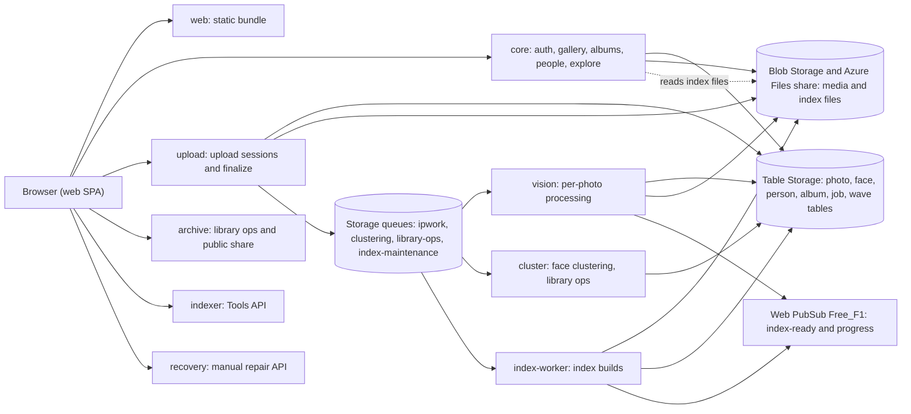
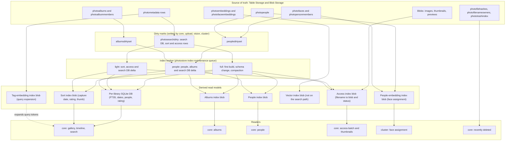
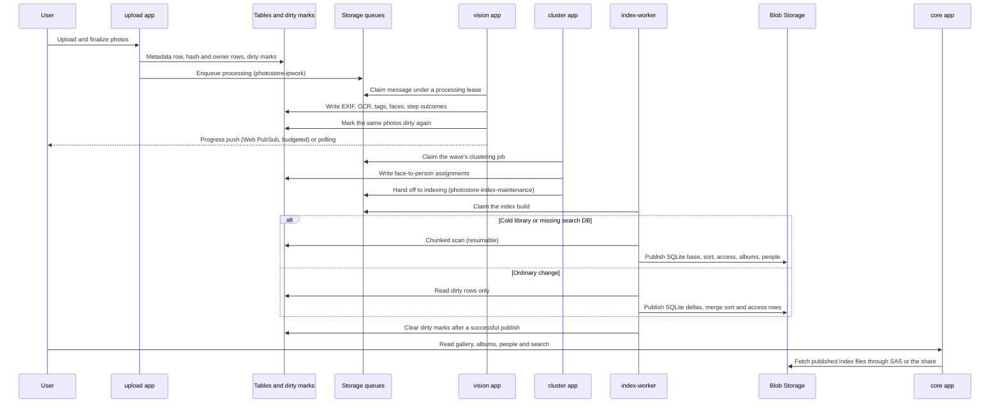
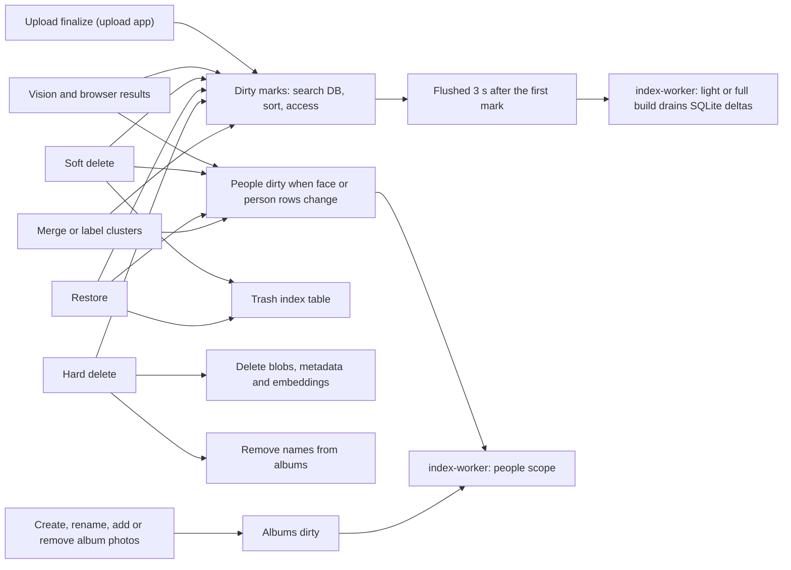

# Backend architecture (as of 2026-11-24)

Scope: the Flask codebase in `backend/` and how it runs as separate Container
Apps. Sections 1-10 describe the current deployment and the synchronous HTTP
request path. Sections 11-15 describe the index read models (search database,
sort/access/albums/people indexes) and the performance instrumentation. The
processing half (vision, clustering, index builds, upload waves) is in
[`docs/ipworker-architecture.md`](ipworker-architecture.md) and
[`docs/indexing-clustering-target-state.md`](indexing-clustering-target-state.md).

Everything below was checked against `backend/app.py`, `backend/routes/`,
`backend/entrypoint.sh`, `backend/gunicorn.conf.py` and `deploy/resources.bicep`.
When a fact changes, update the text here in the same change.

## 0. One image, several roles

The same image (`coreImage`, `ghcr.io/git4rajat/photostore-backend`) runs in
several Container Apps. `APP_ROLE` picks what each one does. `entrypoint.sh`
chooses the process (gunicorn for HTTP roles, a queue loop for worker roles),
and `app.py` registers only the blueprints that role serves.

| Container App (`${appName}-…`) | `APP_ROLE` | Process | Serves / does |
|---|---|---|---|
| `core` | `core` (default) | gunicorn | Auth, gallery and photos, albums, People, Explore, library membership and switching, upload-session reads, activity, index events |
| `upload` | `upload` | gunicorn | Upload init, finalize, processing leases, known-hash checks, corrupted-upload list |
| `indexer` | `indexer` | gunicorn | Tools API (`tools_bp`) only |
| `index-worker` | `index-worker` | queue loop (`run_index_worker`) | Index builds from `photostore-index-maintenance`. Runs as its own app, or as a sidecar inside `indexer` when `separateIndexWorker=false` |
| `recovery` | `recovery` | gunicorn | Manual repair API (`admin_bp`) |
| `archive` | `archive` | gunicorn | Library operations (export, delete, clean), public share pages (`library_bp`, `library_operations_bp`, `public_bp`) |
| `web` | — | static | The frontend bundle |
| `cluster` | `cluster` | queue loop (`run_clustering_worker`) | Face clustering and assignment (`photostore-clustering`), library clean and download jobs (`photostore-library-ops`) |
| `vision` | `vision` | queue loop (`run_ipworker`) | Per-photo processing: preview, thumbnail, EXIF, OCR, faces, vision tags, geo (`photostore-ipwork`). Deployed only when `processingMode` is `backend` or `both` |

`APP_ROLE=wave-recovery` exists in `entrypoint.sh`, but `deploy/resources.bicep`
(around line 2202) deploys no compute for it. There is no scheduled wave sweep
in the current deployment.

Older names still appear in some code comments and in the design docs below.
Translate them with this table: `backend`→`core`, `tools`→`indexer`,
`admin`→`recovery`, `extras`→`archive`, `worker`→`cluster`, `ipworker`→`vision`,
`frontend`→`web`, `upload` unchanged. The `worker` role no longer exists as a
single app; index builds moved to `index-worker` (see §14).

## 1. What `core` is, and the deployment topology

The backend is one Flask application, `backend/app.py` (about 19,800 lines),
with route handlers in 17 blueprint modules under `backend/routes/`
(306 `@…_bp.route(…)` decorators). Shared logic lives in helper modules such
as `storage_utils.py`, `search_db.py`, `library_build.py`, `upload_waves.py`
and `wave_*.py`.

There is no SQL database and no Cosmos DB. Structured data is in **Azure Table
Storage** (`azure.data.tables`), media bytes and index files are in **Azure
Blob Storage** (`azure.storage.blob`), and background work goes through
**Azure Storage queues**. Index files that must be shared between apps are
also kept on an **Azure Files** share (`faiss-checkpoints`), mounted as
`/mnt/photostore/shared` by the index apps and as `/mnt/photostore/faiss-checkpoints`
by `cluster`. Live index-ready and processing-progress messages
use **Web PubSub** on the Free tier (`Free_F1`, `${appName}-index-events`).
Web PubSub is enabled by default (`enableIndexPush`), and polling is the
fallback when it is off or over budget.

Partitioning: most per-user tables use `PartitionKey = library id` (the
library, not necessarily the login account; see §4). `RowKey` is the filename
for photo rows, and `personId/faceId` or similar for face rows.

### Table and queue names (env-overridable defaults)

| Kind | Names |
|---|---|
| Photos | `photometadata` (rows), `photoembeddings`, `photofaceembeddings`, `photoimagenames`, `photofilehashes`, `photofilenameowners`, `phototrashindex`, `photosearchdirty` |
| Faces and people | `photofaces`, `photofacebyfilename`, `photopeople`, `photopersonmembers`, `personmerges`, `peopledirtyset` |
| Albums | `photoalbums`, `photoalbummembers` (members of albums too large for one row), `photoalbumtokens`, `albumsdirtyset` |
| Work and uploads | `photojobs`, `photouploadsessions`, `workbenchactions` |
| Accounts and sharing | `photousers`, `photolibraries`, `photomemberships`, `photoinvites`, `photoaudit`, `photolibraryclean`, `photostoreconfig` |
| Queues | `photostore-ipwork` (+ `-deferred`, `-deadletter`), `photostore-clustering` (+ `-deferred`, `-deadletter`), `photostore-library-ops` (+ `-deadletter`), `photostore-index-maintenance` (+ `-deferred`, `-deadletter`) |

Blob containers include `images`, `thumbnails`, `covers`, `library-exports`,
`merge-payloads`, and the index containers (`lexical-index`, `vector-index`,
`people-embedding-index`, `tag-embedding-index`, plus sort, access, albums and
people indexes).

### Media URLs

Two modes exist (`MEDIA_URL_MODE`, default `sas`; `app.py:713`):
- **SAS mode**: the browser fetches the bytes straight from Blob Storage.
  `GET /api/photos/media-token` returns one container-scoped, read-only,
  day-aligned SAS for the thumbnails container (previews live under `preview/`
  in the same container), and one for the face-crop container. The browser
  builds the URLs itself. See §12 and §15.9.
- **Proxy mode**: `/api/photos/{thumbnail,preview,image,cover}/<filename>`
  streams bytes through the core app. It is the fallback for thumbnails that
  are not ready and for RAW/HEIC.

The user-delegation key is minted once per UTC day and stored as a row in the
metadata table (`_stable_delegation_key`, `app.py:13293`), so all replicas sign
with the same key. SAS start and expiry are day-aligned, so the same blob gets a
byte-identical URL all day and the browser cache stays effective
(`_stable_container_read_sas`, `app.py:13389`).

## 2. Process and thread model (`entrypoint.sh`, `gunicorn.conf.py`, `resources.bicep`)

HTTP roles run `gunicorn app:app` with `--worker-class gthread`. The entrypoint
defaults are `GUNICORN_WORKERS=1` and `GUNICORN_THREADS=2`. Each app sets its
own values in `resources.bicep`:

| App | Declared CPU / memory | Workers × threads | Replicas (min / max) | HTTP scale rule |
|---|---|---|---|---|
| `core` | 0.5 vCPU / 1 Gi (see drift note) | 2 × 2 | 0 / 5 | `concurrentRequests: 4` |
| `upload` | 0.75 vCPU / 1.5 Gi | 2 × 4 | 0 / 5 | `concurrentRequests: 8` |
| `indexer` | 0.5 vCPU / 1 Gi (dedicated) | 1 × 4 | 0 / 1 | `concurrentRequests: 10` |
| `recovery` | 0.5 vCPU / 1 Gi | 1 × 4 | 0 / 2 | `concurrentRequests: 10` |
| `archive` | 0.5 vCPU / 1 Gi | 1 × 4 | 0 / 3 | `concurrentRequests: 8` |
| `web` | 0.25 vCPU / 0.5 Gi | — | 0 / 2 | — |

Queue apps are not HTTP-scaled. KEDA `azure-queue` rules wake them:
- `cluster` (2 vCPU / 4 Gi): one replica max; rules on `photostore-clustering`
  and `photostore-library-ops` (`queueLengthStrategy: all`, so claimed work keeps
  the replica up).
- `vision` (2 vCPU / 4 Gi): one replica max, `IPWORKER_CONCURRENCY=3` per
  replica; rule on `photostore-ipwork`.
- `index-worker` (1.5 vCPU / 3 Gi): one replica max; rule on
  `photostore-index-maintenance`.

Gunicorn settings that apply to every HTTP role:
- `--max-requests 400 --max-requests-jitter 50`: recycle workers so the heap
  fragmentation from image, RAW and video work does not grow RSS until an OOM.
- `--graceful-timeout 60`: bounds the capacity-zero window when a recycle hits a
  single-worker app.
- `--timeout 600`, `--keep-alive 30`.
- `gunicorn.conf.py` `on_starting` starts a stdlib health sidecar on
  `HEALTH_SIDECAR_PORT` (default 5001) in the master process. Liveness probes
  hit that port, so they still get an answer when every app thread is busy.
- `gunicorn.conf.py` `post_fork` pre-builds the offline geocoder in each new
  worker, so the first upload request does not pay for it.

Why more than one worker process on some apps: gunicorn forks before the app
is imported (no `--preload`), so each extra worker process loads its own copy of
numpy, scipy, scikit-learn, Pillow and the Azure SDKs (about 250-350 MB each)
and builds its own caches. Threads share one interpreter's memory, so the
number of threads is the cheap concurrency knob. The `core` and `upload` apps
use two worker processes so one slow request cannot occupy every thread of the
only worker.

**Drift note.** The `core` block in `resources.bicep` declares 0.5 vCPU / 1 Gi,
but comments in the same file say the live dev deployment ran 2 vCPU / 4 Gi
when the 2-worker setting was chosen. Treat the declared numbers as the
template default, not a measurement. Reconcile against the live app before
resizing.

## 3. Data layer

### Access pattern

- A single-entity lookup (`get_entity(partition_key, row_key)`) is a point read.
  `_get_metadata_entity` (`app.py:3077`) and membership checks use this.
- A "list everything for this library" query is a **full partition scan**.
  Azure Table Storage has no secondary index here, so every listing paid for
  proportionally to library size. Sections 14-15 replaced most of these listings
  with SQLite-backed pages and bounded streams. The remaining scans are
  documented per endpoint.
- `_InvalidatingTableClient` (`app.py:1377`) wraps the face and person table
  clients. Any write through it invalidates the matching per-library scan cache
  (§5), so callers do not invalidate manually.
- Batched writes use `_batch_upsert_entities` (`app.py:6206`), capped at 100
  operations per transaction. Batched reads are the 15-row `RowKey eq … or …`
  queries used by the gallery and album pages (§15.2).

## 4. Request lifecycle for an authenticated call

Every non-public route goes through `_require_library_context`
(`app.py:2905`), usually via the `_require_user_id` wrapper (`app.py:3011`):

1. **Session token** (`_resolve_session_payload`, `app.py:2866`): HMAC-signed
   token checked in process by `password_auth.validate_session_token`. No
   storage call.
2. **Account lookup**: `library_store.get_user_checked(user_id)`, a Table point
   read, wrapped in `_auth_lookup_with_retry` (`app.py:2886`): three attempts
   with 50 / 100 ms backoff. A storage blip becomes a retryable 503, not a 401.
3. **Token version**: checked in memory against the account row, so a password
   reset or removal invalidates outstanding tokens.
4. **Membership**: only when the token's active library (`lib` claim) differs
   from the caller's own id. This is another point read, with the same retry
   wrapper. A user's own library is never checked this way.
5. The route handler runs.

So a typical call costs **one Table point read** for auth, and two when the
caller is working in a shared library. `GET /health` (`routes/system.py:15`,
and `app.py:19767` as a fallback for roles that do not register `system_bp`)
skips this path.

## 5. In-process caches

`_UserScanCache` (`app.py:1208`) is a per-library TTL cache with request
coalescing. The first caller for a library runs the partition scan. Concurrent
callers for the same library wait on a lock and reuse the result.

| Cache (`app.py`) | Backs | TTL |
|---|---|---|
| `_person_scan_cache` (`:1325`) | person rows with embeddings | `PEOPLE_SCAN_CACHE_TTL_SECONDS`: 20 s default; 120 s on `vision` (`resources.bicep`) |
| `_face_summary_scan_cache` (`:1326`) | face summaries | same |
| `_people_embedding_index_cache` (`:1330`) | built people-embedding index | same |
| `_person_light_scan_cache` (`:3192`) | person rows without embeddings | same |
| metadata row cache | photo rows | removed: `_cached_metadata_rows_for_user` now raises (§14.2) |

Invalidation: `_invalidate_people_scan_cache` (`app.py:1333`) is called from
`_InvalidatingTableClient` on every face or person write.

**Capacity caveat.** These caches are process-local. Replicas do not share
them, and each replica pays a fresh scan on the first hit for a library. With
one worker process per replica, the threads of that replica share the cache.
If the worker count goes up, or replicas routinely outnumber the work, move
the hot caches to a shared store. The table-backed delegation-key pattern (§1)
is the existing precedent.

## 6. CPU-bound work under a shared GIL: the lesson

Threads are good for I/O waits (table and blob round trips), and bad for
CPU-bound Python (JSON parsing, numpy, image decode). Under the GIL, extra
threads add contention without adding throughput.

Measured case: `GUNICORN_THREADS` was raised from 4 to 12 on the dev
deployment to relieve slow `/upload/finalize`, `/upload/init-batch` and
`/upload/client-processing` calls. The processing-claim endpoint got faster, but
the three target endpoints got slower (p50 37-45 s → 60-67 s, p90 85-94 s →
197-240 s). The change was reverted. The actual cause was an
O(library-size) people-embedding index rebuild on every uploaded photo. The
fix was a cached index (`_people_embedding_index_cache`, `app.py:1330`) plus a
vectorized best-two-match function (`_best_two_person_matches`,
`app.py:5684`).

**Rule for this app.** CPU% per replica under-reports this failure, because the
cost is O(library) Python work repeated per request, not one slow call. When a
handler is slow under concurrency but CPU is not pegged, first look for
per-request full-partition work. Do not raise thread counts to fix it. The
comments in `resources.bicep` (core and upload blocks) repeat this warning.

## 7. Prior incidents and the fixes that are in code

- **Worker-recycle blackout.** A single-worker app with periodic recycling lost
  up to ~120 s of capacity. Fixed by bounding `--graceful-timeout` to 60 s, and
  by running two workers on `core` and `upload`.
- **Dead-end liveness probes.** A slow request could hold every thread of the
  only worker, so the liveness probe got no answer and the container restarted
  in a loop. Fixed by the master-process health sidecar (`gunicorn.conf.py`).
- **`/api/persons` and `/api/faces` were unpaginated full-account scans.**
  Now paged (`/api/persons/page`, §15.10).
- **Upload dispatch-gate retry convoy.** Retry-in-place on `init-batch` and
  `finalize-batch` with a fixed concurrency cap let one stuck request hold a
  slot for up to ~33 minutes and stall the batch. The cap is now bounded and
  adapts to backend congestion.
- **Redundant read-modify-write on finalize.** `finalize_uploaded_file` used to
  read the metadata row back just to set processing-status fields. The status
  fields are now written in the first upsert (`storage_utils.py`, comment near
  line 11783).
- **People-embedding index rebuilt per photo.** Fixed by the cached, vectorized
  index (§6).
- **Serving processes must not build indexes.** Enforced by `index_build_allowed()`
  (§14.4).

## 8. Earlier hot-path findings (superseded)

The two patterns that earlier versions of this doc flagged are now handled:
- `GET /api/photos` no longer loads and sorts the whole metadata partition. It
  pages with SQL on the library database (§14.2).
- `POST /api/photos/access-batch` no longer does one point read per filename on
  each call. It uses a compact per-index filename map (§14.2).

## 9. Summary of current numbers

| Metric | Value (source) |
|---|---|
| Route decorators | 306 across 17 modules in `backend/routes/` |
| `app.py` size | about 19,800 lines |
| Container Apps with an HTTP surface | `core`, `upload`, `indexer`, `recovery`, `archive`, `web` |
| Queue-driven apps | `cluster`, `vision`, `index-worker` (+ `wave-recovery` role, not deployed) |
| Gunicorn defaults (entrypoint) | 1 worker × 2 threads; per-app values in §2 |
| Gunicorn recycle | 400 ± 50 requests; graceful timeout 60 s; request timeout 600 s |
| Auth cost per request | 1 Table point read (+1 for a shared-library membership check) |
| Per-library scan cache TTL | 20 s (120 s on `vision`) |
| Table scan parallelism | `TABLE_SCAN_PARALLELISM=4` (`table_scan.py`) |
| Search DB | per-library SQLite (FTS5) on ephemeral disk; candidate window 4000; compaction at 200 deltas (§13, §15.4) |
| Sort-index browser cap | `SORT_INDEX_CLIENT_MAX_ROWS=200000`; above it the gallery pages from the server (§15.6) |
| Web PubSub | `Free_F1`, enabled by default; progress push budget `INDEX_EVENTS_PROCESSING_DAILY_BUDGET=1500` (`index_events.py`) |
| Face clustering presets | `PEOPLE_CLUSTER_PRESET`, default `strictest` (cosine ≥ 0.80) |

## 10. Open items

These are the items that the current code still leaves open. Measurements
for each are in §11-§15.

1. **Library-proportional work on serving roles.** The access map and the
   albums and people indexes are sized by album or person count, not photos.
   They are bounded but not free (§14.2, §14.4).
2. **Backend disk at 1M photos.** Each replica keeps a copy of the library's
   search database. Check `sqlite_mb` against the local disk before raising the
   library size (§15.5).
3. **Browser sort index.** Above 200,000 photos the gallery pages from the
   server. Nothing in the browser holds the whole library index (§15.6).
4. **Replica-local caches (§5).** This becomes a hit-rate problem if the
   worker count goes up or replicas routinely outnumber work.
5. **Thread counts (§6).** Before raising `GUNICORN_THREADS` again, look for
   per-request O(library) Python work first.

## 11. Large-library index path (130k photos) — instrumentation, slim index, disk cache

**Reading the logs.** Every line starting `PERF` is key=value (`perf_instrumentation.py`):
- `event=request` — `ms`, `inflight`, `rss_delta_mb`, and the top spans for that request; WARNING when `ms >= PERF_SLOW_REQUEST_MS` (1000).
- `event=mem` — every 15s: `rss_mb`, `threads`, `inflight`, `inflight_peak`. `PERF_MEMORY_WARN_MB` adds an `mem_high` warning.
- `event=span name=index.<kind>.{download,gunzip,json_parse,table_scan}` / `index.serialize` / `index.search_slim.build` — which phase of an index load/build dominates and how much RSS it adds. `index_disk_cache_hit|store` shows disk-cache behaviour.
- `PERF_INSTRUMENTATION=false` disables all of it.

**Search.** There is no browser-side search or search index any more (the 709 MB lexical blob could never load in a tab, and with server search frozen every query came back empty). See section 13.

**Indexes on the shared volume.** With `INDEX_DISK_CACHE_DIR` set (the indexer and index-worker apps: `/mnt/photostore/shared/index-cache`; cluster: `/mnt/photostore/faiss-checkpoints/index-cache`, both on the same `faiss-checkpoints` Azure Files share), `_get_blob_client` returns a `_ShareBackedBlob` for the four index containers, covering every index kind (sort, lexical, listing, access, albums, people, vector, people/tag embeddings, explore, timeline); the SQLite search database is deliberately excluded (section 13). Uploads write through to the share; downloads are served from it when the blob's ETag sidecar matches (one `get_blob_properties`), else fall back to Blob and refill. Blobs under `INDEX_DISK_CACHE_MIN_BYTES` (manifests) bypass it. Blob Storage stays the source of truth and any share error falls back to it. **Session start:** `/api/photos/index-status` (called once per session) kicks `warm_user_index_files_async`, which streams every index blob for the user onto the share (single-flight, `INDEX_WARM_COOLDOWN_SECONDS`=300), without holding any in memory. Browsers cannot mount SMB, so they still download via SAS URLs from Blob (now of the slim blobs) and keep them in IndexedDB.

**Timeline.** `/photos/timeline` serves a summary precomputed by the index build (`refresh_user_timeline_summary`) instead of loading the listing index into the core app.

**Client.** `preloadLocalIndexes()` starts the media token and the sort, albums and people index downloads concurrently once `/api/photos/index-status` reports ready. There is no browser search index any more; `/api/photos/search-index` is a retired stub and `/api/photos/search` is the only search path.

## 12. Token-based media: thumbnails with no backend per page

**Before** (HAR, microsvcpoc-dev): every `lookup-batch` page of 100 photos signed 3 SAS URLs per photo on the backend (full image, thumbnail, thumbnail again) -- 300 distinct signatures and a ~160 KB response, and the thumbnail URLs were only available after that call.

**Now.**
- `GET /api/photos/media-token` returns ONE container-scoped, read-only, day-aligned token for the thumbnails container (`_stable_container_read_sas`); previews are in the same container under `preview/`, so it covers both. No list permission: blobs are reachable only by their unguessable UUID names. Same exposure class as the per-blob SAS URLs it replaces, but note it is a bearer token for the whole container -- rotate by rotating the user-delegation key / shortening the day-aligned window if that ever matters.
- The sort index (schema v2) carries `thumb` (physical thumbnail blob name, once the thumbnail exists) per photo.
- The browser (`services/mediaToken.ts`) caches the token in memory + localStorage until 30 min before expiry and builds `{baseUrl}/{blob}?{sas}` itself. The grid (`mockups/prototype/store.tsx` `fetchPhotos`) paints each page straight from sort-index rows + token -- no backend call -- then enriches in the background with `lookup-batch {directMedia: true}`, which skips all URL signing and returns `thumbnailBlob` instead. Proxy/preview fallbacks (thumbnail not ready, RAW/HEIC) keep their normal URLs.
- The Tools API (`indexer` app) upgrades existing libraries: `/api/tools/indexes/build` runs `ensure_user_sort_index_current` (full sort-index rebuild when the stored schema is older). Until then rows lack `thumb` and the grid simply waits for the enrichment call, as before.

Known gaps: provisional tiles lack per-user `liked`, people, tags and `thumbnailRotation` until enrichment lands (normally well under a second); a tab left open past the token's expiry needs a reload to refresh already-built URLs; Albums/People/Explore/Search result grids still use their own URL sources. The Gallery now sizes each step to the screen: `measureGridCapacity()` reads the live `.pt-grid` column count / tile width and loads ~3 viewports of tiles (60-600) per step, painted straight from the sort index; only the metadata enrichment is chunked (100 per `lookup-batch`, in parallel).

## 13. Search: per-library SQLite (FTS5) database on ephemeral disk

**Why.** Search was returning nothing: the browser could not load the 709 MB index and `/photos/search` was frozen because the old implementation loaded the whole lexical index into the 1Gi backend and scored every row per query.

**Now** (`backend/search_db.py`):
- **Build (index-worker).** Cold or schema-stale libraries are built by the queued `index_build` job. `library_build.bootstrap_library_build` creates an empty base and then streams the metadata table in chunks, publishing SQLite deltas as it goes and spooling sort/access parts. The DB holds a compact scorer-compatible row per photo (deduped, confidence-filtered tags; see `reduced_row` and `SEARCH_INDEX_*` env vars), an FTS5 index over the exact texts `lexical_search_score` matches against (filename, effective tags, semantic text incl. OCR, location, camera model), a `person -> photos` table, a capture-day column and the library's place-name vocabulary. ~100 MB / ~40 s for 130k synthetic photos.
- **Query (core).** `open_database` copies the current DB to **local ephemeral disk** (`SEARCH_DB_DIR`, an EmptyDir mount; streamed, once per replica per version, oldest files evicted past `SEARCH_DB_MAX_CACHE_MB`) and queries it read-only. `/photos/search` takes the top `SEARCH_DB_CANDIDATE_LIMIT` (4000) bm25-ranked candidates (OR of query terms, their singular/plural variants, expansions, 4+ char prefixes; plus rows of named people), then runs the unchanged hard filters + `_score_search_row` on just those rows and point-reads full metadata for the returned page. Nothing library-sized is held in memory.
- **Not on the share.** SQLite needs a real local filesystem; `-searchdb` blobs bypass the Azure Files layer. `/api/photos/index-status` (session start) kicks `search_db.warm_async` so the first search doesn't pay for the download.
- **Cold library.** No current DB -> `/photos/search` returns `{photos: [], total: 0, searchIndexBuilding: true}` and requests a build; Ask shows a "preparing" notice and retries for ~2 minutes.

**Behaviour changes to know about.** Semantic (CLIP) scoring is gone from the live `/api/photos/search` route -- it passes no query embedding and no vector scores. Ranking is lexical, with optional tag-embedding query expansion when an ipworker-built tag index exists. The first `SEARCH_DB_CANDIDATE_LIMIT` matches are relevance-ranked; if the result set is larger, `total` is exact and later pages continue newest-first with `rankedWindow` in the response. The `/api/photos/search-index` route is a retired stub.

## 14. Index builds run on the worker, not inside a tools HTTP request

**The failure.** "Library index build failed — Job did not finish (worker restarted or timed out)" is the `index_build` job (one row per library, `index-build-<libraryId>`). `/api/jobs/status` rewrites any queued/running job whose row hasn't been updated for `CLUSTERING_ACTIVE_JOB_STALE_MINUTES` (15) as failed with that text. The build used to run inside `POST /api/tools/indexes/build` on the scale-to-zero `tools` app: ingress cuts requests at ~240 s, after which nothing counted as in-flight, so a scale-down (or an OOM restart of the 4Gi replica while holding the whole library in memory) killed it mid-step; and the job row was only touched *between* indexes, so one long step (full-table scan, search-database build) could trip the 15-minute sweep even while alive.

**Now.**
- `tools_build_indexes` only decides whether a full build is needed (`index_build_needed`: missing readiness, old sort-index schema, missing/stale search DB; upload dirtiness is handled by light/people scopes) and `enqueue_index_build` sends a `{type: 'index_build'}` message to the index-maintenance queue (`photostore-index-maintenance`) and returns immediately. Core, upload and vision requests reach the same function. Status (`/api/tools/indexes/status`) reads the shared job row, not a per-process lock.
- The `index-worker` role consumes it (`run_index_worker`, `_run_index_build_job`): same lease renewal, bounded retries, dead-letter queue and SIGTERM handling as library clean/download; a failed or killed build is redelivered. A heartbeat thread rewrites the job row every `INDEX_BUILD_HEARTBEAT_SECONDS` (30), so a live build is never declared dead, and a truly dead one is. The index-worker mounts the same Azure Files share and `INDEX_DISK_CACHE_DIR`, so indexes it builds are written through for every other role; consumers still locate them by deterministic blob name (no path hand-off needed).

**To verify after deploy:** `PERF event=span name=index.build.job` / `index.<kind>.table_scan` / `searchdb.*` show where time goes and `rss_mb` shows memory per step; if the index-worker still restarts mid-build, the usual cause is memory (the lexical snapshot holds every metadata column in Python objects) -- look for `event=mem` climbing toward 4Gi before the restart. No replica floors are assumed: the worker scales from the library-ops queue rule, and the outstanding (in-flight) message keeps it up.

### 14.1 Bounded-memory build (the OOM fix)

The old 'lexical' step built a full in-memory snapshot of the library (`list(query_entities)` of every column incl. the ~10 KB/photo embedding columns, a trimmed copy, a serialized 700 MB JSON, a gzip copy, a listing copy) and then Explore, timeline and the search DB each reloaded it. That is several GB of Python objects at ~130k photos.

Now `storage_utils.stream_library_artifacts` makes **one paged pass** with a server-side column projection (`_STREAM_SELECT_FIELDS` -- embeddings are never downloaded) and offers each row to small sinks, then drops it:
- `ListingSink` -- gzip-streams the listing blob to a temp file;
- `search_db.SearchDbSink` -- streams into SQLite (2000-row batches), gzips and uploads;
Sort and access scans also iterate instead of `list()`. The 700 MB full lexical blob is **no longer built** (nothing reads it any more; `get_user_listing_index` no longer falls back to building it on the backend either). Nothing is published unless the whole scan succeeds; the lexical manifest (readiness / freshness / dirty flag) is written last.

Measured on identical synthetic data (8,000 photos with 12 KB of heavy columns each): old build peak 288 MB (grows linearly with library size), streaming build peak 2.7 MB. `tests/test_library_stream.py` pins this (peak < 25 MB). Builds are a full scan, so `enqueue_index_build` delays a rebuild that follows a finished one by `INDEX_BUILD_MIN_INTERVAL_SECONDS` (120) instead of letting upload bursts trigger back-to-back builds.

### 14.2 No request path loads the library

The backend (1Gi) used to hold library-sized data in memory for several endpoints. Each now uses a bounded technique:

| Endpoint / helper | Before | Now |
|---|---|---|
| `GET /photos` (list), `GET /photos/filter` (route since removed) | whole listing blob (130k rows) loaded + sorted in Python | SQL `ORDER BY/LIMIT/OFFSET` on the per-library SQLite DB (`SearchDatabase.list_page` / `filter_page`); page metadata re-read fresh (parallel point reads). Ordering/filter parity with the old in-memory logic is pinned in `tests/test_library_db_routes.py` |
| `/api/suggestions` (on this day; route since removed) | pass over the listing | `GROUP BY capture_year WHERE capture_md = ?` |
| `/api/search/suggest` (places; route since removed) | pass over the listing | place vocabulary stored in the DB |
| album covers (`_album_cover_thumbnail_url`) | full unprojected, sorted scan of every row | `SearchDatabase.top_rated(album filenames)` (chunked `IN`, O(limit)) + <=12 point reads |
| `access-batch` | whole access index copied (130k rows) and re-indexed **per call** | one compact filename map per index version (`lookup_access_entries`), no copies; the backend never builds the index |
| trash list / restore-all | all columns of all rows, filtered in Python | server-side `processing_state eq 'deleted'` + projection |
| corrupted-uploads page | whole-library scan | server-side `verification_status eq 'failed' or corrupted eq true` + projection |
| smart-album creation, admin backfill, browser-processing pending, ipwork sweep | list of all rows | `_iter_metadata_rows_for_user` streaming with narrow projections |

`_cached_metadata_rows_for_user`, `_cached_sorted_metadata_rows_for_user`, `_cached_metadata_list_rows_for_user` and `_cached_sorted_metadata_list_rows_for_user` now **raise** (`tests/test_bounded_scans.py` also fails the build if any route module references them), so a future caller cannot silently reintroduce a whole-library load. `_invalidate_metadata_scan_cache` remains as a no-op for the many write paths that call it.

Behaviour notes: rating/like changes reach list/filter/cover ranking on the next index build (minutes); the photos returned are always fresh. With a location filter active, photos without coordinates are excluded (the old code compared them as 0,0). A library with no current database yet gets `indexBuilding: true` from list/filter and a worker build is requested. The database schema is `sqlite-v2`; existing databases are rebuilt by the next build.

Remaining library-proportional memory on the backend: the compact access map (~tens of MB per worker, loaded once per index version) and the albums/people indexes (sized by album/person count, not photo count).

### 14.3 People: no 200-cluster cap

Accounts have tens of thousands of clusters. The primary People path (the people index blob, downloaded once per session) was never capped; the cap lived in the fallback used when that index is unavailable (`listPersons(undefined, 0, 200)`), so a failed/cold index build meant only 200 people were visible.
- `GET /api/persons?namesOnly=1&covers=1` returns **every** cluster in one request -- name, `isNamed`, `faceCount` and a `coverFaceId` chosen (confirmed > confidence, never rejected) from the in-memory bulk face map: no per-person lookups and no thumbnail signing, which is the per-page work the paged endpoint does and why it pages. The original measurement was 30,000 clusters in under 1 s; no test file by that name exists in the current tree. Without `covers=1` the response shape is unchanged.
- `faceService.listAllPersons()` replaces the capped call in the store's fallback; covers load lazily via `/api/faces/crop/<id>`.
- People grid is windowed (`useWindowedGrid`) so only on-screen cards render and only their covers are requested (it used to request every cover); selection lookups use a Set; the merge picker on a person page is searchable and renders at most 200 options (a `<select>` with 30k options freezes the tab).

### 14.4 Index builds never run in a serving process (the `extras` OOM)

**Incident (microsvcpoc-dev-extras, 0.5 vCPU / 1Gi):** RSS climbed 289 -> 1007 MB within ~2 min of a rollout with `inflight` 1-2, was OOM-killed, and repeated until `Persistent Failure to start container`. Cause: the first People request ran the **people-index build in-process** (`get_user_people_index` -> `_rebuild_people_index_in_background`). `_build_user_people_index_snapshot` did `list(query_entities(...))` of every column of every person **and every face**, including each face's `embedding` and each person's `repEmbedding` (512-float JSON, ~6-8 KB each). Measured on identical synthetic data (distinct 6 KB embedding strings per row): old build **180.6 MB peak at 4,000 persons / 20,000 faces** (~1.35 GB extrapolated to 30,000 / 150,000), new build **12.9 MB**.

**Structural guard.** Only `index-worker` may build indexes (`INDEX_BUILD_ROLES`, default `index-worker`; `index_ownership.configured_build_roles()` rejects any other role, and `storage_utils.index_build_allowed()` checks it). In every other process -- core, upload, indexer, recovery, archive, cluster and vision:
- the six `_rebuild_*_in_background` kickers are decorated with `_builds_only_where_allowed` and become *"request an index-worker build"* (`INDEX_BUILD_REQUEST_HOOK` -> `enqueue_index_build`, deduped/throttled);
- the synchronous branches of every `get_user_*_index` (sort, access, albums, people, vector, tag-embedding, people-embedding) return `None`/stale data and request a build instead of scanning;
- `_load_people_embedding_index` no longer falls back to scanning person rows (with embeddings) when the durable blob is absent.
`tests/test_index_build_guard.py` makes the person/face/metadata/embeddings tables explode on any scan in a serving process and asserts a build is requested instead.

**Builders are bounded too** (they run on the index-worker, 3 GiB, and that is also finite):
| Builder | Fix |
|---|---|
| people index | server-side column projection (no embeddings), streamed, compact face map; no thread pool per person |
| people-embedding index | projected + streamed; reps go straight to float32 arrays (not Python float lists, ~28 B/number) |
| vector index | streams the embeddings table into one normalized float32 vector per photo instead of holding every ~8 KB row JSON; narrow metadata projection; ~63 MB -> ~25 MB at 6,000 photos, result array ~2.2x |
| tag-embedding index | streams only the tag-related columns into a set |
| lexical / listing / search DB / explore / timeline | already one streamed pass (14.1) |
| sort / access | iterate instead of `list()` (14.1) |
A scan failure now aborts the build (vector/tag-embedding) instead of being persisted as an empty index.

**Light person rows.** `_cached_person_rows_for_user(user_id, with_embeddings=False)` (separate `_person_light_scan_cache`, invalidated with the others) drops `repEmbedding`; the People list/roster and the name index use it. Embedding readers keep the default.

**Remaining library-proportional memory on serving roles:** the assignment index loaded from the durable blob on the upload role (`repEmbedding` as Python lists, roughly 0.5 GB at 30k clusters -- moving per-photo assignment to the worker via `PEOPLE_ASSIGNMENT_ENGINE=faiss` removes it) and the compact access map (14.2).

### 14.5 Index builds run on disk, and uploads alone never trigger a heavy rebuild

* `backend/index_files.py` provides the disk-backed toolkit (`workspace`, `RowsWriter`/`iter_rows`, `DiskKV`). The people index keeps its face table in SQLite on disk, and the vector index streams embeddings into an `.npz` file and uploads from the file; neither holds library-sized lists in memory. `INDEX_BUILD_WORK_DIR` points the worker at the Azure Files share. SQLite scratch (`INDEX_BUILD_SQLITE_DIR`) stays on local disk.
* Per-library caches are bounded (`INDEX_CACHE_MAX_ENTRIES`), so a serving process cannot accumulate every library's index.
* Build scopes: `full` (search DB + sort/access + albums/people), `light` (sort/access + search DB deltas, separate job row `index-build-<lib>-light`) and `people` (people/albums + search DB deltas, separate job row `index-build-<lib>-people`). Vector and tag-embedding indexes have separate dirty manifests but are not part of the live `/api/photos/search` ranking path.
  * Dirty manifests seen after uploads, and ipworker drains, enqueue `light` builds only.
  * `full` runs when an index has never been built or the search DB is missing, after a clustering job, and after a Workbench/tools action.
  * `index_build_needed` ignores dirtiness and only reports cold, outdated-schema or missing-search-DB libraries.
* The vector index is always a full streaming pass; nothing on a serving path reads it.

The sort and access indexes follow the same rule. `_refresh_rows_index_on_disk` streams rows from the table into a gzip file and uploads from that file. It also mirrors the file to the share (`_ShareBackedBlob.upload_file`). An incremental refresh streams the previous file through and swaps in only the dirty rows. The snapshot it returns has no rows, and callers that need them reload from the blob.

## 15. Performance instrumentation (find slow steps, extra round trips, duplicate work)

Everything logs as `PERF event=...` lines (core, the queue roles, and the browser through `POST /api/perf/client`), so one Log Analytics query set covers the whole path. Switch off with `PERF_INSTRUMENTATION=false` on the backend and `localStorage['photostore.perf']='off'` in the browser. Query strings (SAS tokens) are never logged.

**Backend (`perf_instrumentation.py`)**
- Every Azure Table, Blob and Queue call is traced at the SDK transport. Each request and job records round-trip count, storage time, bytes and the top operations. These are labelled `table:GET:photos(..)` or `blob:GET:lexical-index`, with ids collapsed.
- `event=request` now carries `rid`, `view`, `sess`, `io_calls`, `io_ms`, `io_mb` and `io_top`. The response gets `X-Request-ID` and `Server-Timing: app;dur, storage;dur`.
- `event=dup_io` is logged when one request or job repeats the same storage call `PERF_IO_DUP_WARN` (3) or more times.
- `event=scope_summary` is logged per queue message, per vision message and per index-build job. It includes wall time, I/O, peak RSS, the slowest spans and `io_top`.
- `event=step` is logged per phase of a job (`index.prime.<kind>`, `index.<kind>.table_scan|fetch_previous|upload`). It reports the storage calls made inside the step. This tells a slow step apart from a chatty one.
- `event=stream_scan_split` breaks the library scan into time waiting on the table versus time in each sink, such as ListingSink or SearchDbSink.
- `event=io_totals` is logged every sample interval with process-wide storage calls ranked by time.

**Browser (`services/perf.ts`)**
- Every API call records its duration, bytes, retries and the server and storage time from `Server-Timing`. It also carries `X-Request-ID`, `X-Client-View` and `X-Client-Session`, so a browser event joins the backend line.
- Duplicates are flagged: the same request completed twice within 15 s (`event=client_dup kind=request`), concurrent identical GETs that were coalesced, and one blob fetched through several URLs or re-downloaded (`blob-multi-url`, `blob-refetch`). The last two are exactly the thumbnail double-download case.
- `event=client_view` summarises each page: requests, network time, duplicates, resources, cache hits and long tasks. `event=client_span` covers the index preload phases for sort, albums and people (manifest, IndexedDB read, blob download, parse, IndexedDB write, total, cached or not) and the media token. Web vitals are logged as `client_vital`.
- In the browser console, `photostorePerf.report()` prints slowest, chattiest and duplicate tables, plus `summary()` and `events()`.

**Starting queries**: ready-made KQL for all of the below is in `docs/perf-queries.kql` (Log Analytics, `ContainerAppConsoleLogs_CL`).
- Slowest endpoints: `event=request`, order by `ms`. Compare `io_ms` with `ms` to see whether time is storage or app work.
- Chatty endpoints: `event=request`, sort by `io_calls`.
- Duplicate storage work: `event=dup_io`, grouped by `call`.
- Slow builds: `event=scope_summary name=index.build.*`, then drill into `event=step` and `event=stream_scan_split`.
- Client versus server: join `client_req` and `request` on `rid`. `ms - serverMs` is network plus queueing.
- Duplicate downloads: `event=client_dup`, grouped by `kind`.

### 15.1 Fixes made from the first production PERF data

- **Job status:** `/api/jobs/status` filters server-side (in-flight or recently updated). Finished rows older than `JOB_RETENTION_DAYS` (14) are swept in the background, at most hourly per user (`event=job_sweep`).
- **Naming a person:** faces are confirmed with parallel reads and 100-row write transactions. Each step logs `event=step name=label.*`.
- **Smart albums:** read from the library's local search database (`SearchDatabase.iter_smart_rows`) when a current one exists, and fall back to the table scan otherwise. Groups are the same as the table scan's, except tags: the database keeps only the high-confidence tags.
- **Parallel partition scan (`table_scan.py`):** the library scan reads RowKey ranges concurrently and still returns rows in RowKey order. Hot prefixes (`IMG_...`) are split on the fly. Settings: `TABLE_SCAN_PARALLELISM` (default 4, 1 = off), `TABLE_SCAN_SPLIT_ROWS`, `TABLE_SCAN_QUEUE_ROWS`.
  - `event=table_scan` logs rows, ranges and ms. Compare ms per 1000 rows with `TABLE_SCAN_PARALLELISM=1`.
  - Azure documents a soft target of about 2,000 entities per second per partition, so expect a gain of up to roughly 2x. Watch for 503s on the table when raising the worker count.
- **Thumbnails:** every grid builds its thumbnail URL from the sort index's blob name and the single container token. A thumbnail loaded on one page is then a browser-cache hit on the others. Album covers use the same path.
- **Duplicate-call detection:** table queries are keyed by a hash of their `$filter`, so `dup_io` means the same query was repeated.
- **Not changed:** `finalize-batch` still makes about 12 storage calls per file. That would need a batched finalize across files.

### 15.2 Fixes from the browser smoke test

- **Trash:** membership comes from a small trash index table (`TRASH_INDEX_TABLE`, default `phototrashindex`; PartitionKey = library, RowKey = filename). It is maintained on soft delete, restore and purge. Before this, "list trash" was a server-side filtered scan of the whole library, about 45 s at 130k photos even with an empty trash.
  - The first call per library builds the index with one scan, then later calls are a query over only the trashed rows.
  - The listing reads just the requested page fresh and prunes stale index entries.
- **Gallery pages:** a page's rows are fetched 15 per query (`RowKey eq .. or ..`), in parallel, instead of one point read each. This is about 4 round trips instead of 48.
- **People:** the face and person scans use the parallel scan. Merge suggestions read only named people instead of every cluster's embedding, which was both minutes of work and a memory risk on the extras app.
- **Smoke script:** it now retries cold-start gateway errors, warms all three apps first and reports cold-start times separately. It decompresses blobs only when the bytes start with the gzip magic number. The earlier "Failed to fetch" on the index blobs and thumbnails was this script bug, not the app.

### 15.3 Delete and merge paths, reviewed for the same patterns

The smoke test did not call destructive routes. These were read for the patterns it exposed: full-table scans per call, one-at-a-time storage calls, and heavy work inside the request.

| Route | Problem found | Change |
| --- | --- | --- |
| `POST /api/persons/<id>/merge` and `/merge/batch` | `_merge_persons_core` scanned the whole face table for every pair, so a 50-pair batch did 50 full scans. It also read every moved face one at a time. | One shared snapshot per batch, parallel face reads, and parallel member-row writes. |
| `POST /api/persons/<id>/label` | Identity propagation, a full face-table scan, ran inline. | It is queued to the worker like merge, with the inline path only as a fallback. The response now carries `propagateJobId`. |
| `POST /api/persons/merge/<id>/undo` | Sequential per-face reads and writes. | Parallel. |
| `POST /api/persons/delete` and `/<id>/delete` | Per-face sequential reads and writes, and clusters deleted one after another. | Faces and clusters are released in parallel. |
| `POST /api/photos/trash/purge` (hard delete) | Read every cluster's embeddings while reconciling people. It also scanned the whole library in the request to clean stale `peopleIds`. | Projected columns only, parallel scan, and the library-wide cleanup runs in a background thread. |
| `POST /api/albums/<id>/photos/add` | One sequential point read per photo to check it exists. | Batched queries, about 4 round trips per 50 photos. |
| `POST /api/photos/delete` and restore | Already parallel point reads and writes. | Trash-index update per photo only. |

Known remaining cost: purge's job-row cleanup still reads the user's jobs partition. The retention sweep (§15.1) keeps that small.

### 15.4 Incremental search database (no full rebuilds for normal change)

A full library rebuild is minutes at 130k photos and does not scale to millions, so ordinary change is now applied as small **deltas**.

- **Worker (`refresh_user_search_db_incremental`):** reads the changed filenames from the `lexical` dirty table and fetches just those rows (15 per query, in parallel). It publishes a delta blob `<key>-searchdelta-NNNNNN.json.gz` of upserted photos and removed filenames, then advances `deltaSeq` in the manifest with a compare-and-swap on its ETag. A concurrent full rebuild therefore cannot be overwritten. Large changes go out in chunks of 5000. A dirty-table outage reports `unavailable`; it is never read as "nothing changed".
- **Replicas (`search_db.sync_deltas`):** `open_database` compares the manifest's `deltaSeq` with the local copy's `delta_seq` and applies the missing deltas in place, in one WAL transaction each, so readers never block. A joining replica downloads the base file once, then applies the deltas. An updated photo's old FTS entry is removed by re-deriving the exact indexed document. If a delta can't be fetched, the replica keeps serving what it has and retries on a later request.
- **Compaction:** one full rebuild (`prime ... kinds=('lexical',)`) runs only when the delta log reaches `SEARCH_DB_DELTA_MAX_COUNT` (200), the deltas cover more than `SEARCH_DB_DELTA_MAX_ROW_FRACTION` (25%) of the base, or more than `SEARCH_DB_DELTA_MAX_NAMES` changed at once. A new base resets `deltaSeq` and deletes the old deltas.
- **Timeline** is computed from the replica's database (`timeline_summary`, cached until the next delta), so it reflects new uploads immediately.
- **Manifest reads** are cached for 5 s (`SEARCH_DB_MANIFEST_TTL_SECONDS`) instead of one storage call per request.

Build scopes and triggers:

| Scope | Runs | Triggered by |
| --- | --- | --- |
| `full` | everything | library never indexed, schema upgrade, compaction request |
| `light` | sort + access indexes, then the database delta | vision queue drain / every 10k files, dirty sort/access observed, Workbench action |
| `people` | people + albums indexes, then the database delta | a clustering, recluster or propagate job finishing |

Each scope has its own job row and trigger cooldown. `light` and `people` touch different indexes, so vision and cluster do not repeat each other's work; whichever runs second finds the dirty set empty and its delta step is a no-op.

Still full-rebuild-only: the Explore places/things summary. Still O(library) per light build: the sort and access index files (streamed on the worker, but a million-photo sort index is too big for the browser either way).

### 15.5 Indexing a 1M-photo library

**Targets**

| Target | How it is met |
| --- | --- |
| A first build can finish despite restarts, deploys and scale events | `library_build.bootstrap_library_build` is chunked and resumable. The cursor and the delta publish are one atomic manifest update, so a restart loses at most one chunk (20,000 photos). |
| Search is usable long before the build ends | An empty base database is published first and every chunk is appended as a delta. Responses carry `indexPartial: true` until the build finishes. |
| One table scan, not four | The same pass produces the search rows, the sort-index rows and the access-index rows (spooled per chunk, then assembled). Before this it was a scan for the sort index, another for access, another for search, and the listing blob had no consumer. |
| Memory is bounded | O(chunk), about 20-40 MB. |
| Disk is bounded and checked | The index-worker holds its local database copy plus one snapshot during compaction, and compaction refuses to start without enough free disk (2.5x the database + 64 MB). The spool is removed when the build ends. |
| No repeated full rebuilds | Normal change is deltas (§15.4). Compaction folds the delta log into a new base from the index-worker's local copy and never reads the table. The scan build runs only for a library with no usable database (new, or a schema upgrade). |
| The first build does not starve live traffic | `LIBRARY_BUILD_MAX_ROWS_PER_SECOND` throttles the scan (0 = unlimited, the default). |

**Compatibility:** `deltaSeq` is global to a lineage; compaction changes the base's `sourceVersion` and `baseSeq` but not the lineage. Readiness (`search_db.is_current`) compares lineages, so a compaction does not make the library look "stale".

**Summaries:** Explore and the timeline are recomputed from the finished database after a first build and after each compaction (`_finalize_library_summaries`), not from another scan.

**Operating it:** PERF events `library_build_started|resumed|progress|done`, `searchdb_delta_published`, `searchdb_compacted` (queries 13-14 in `docs/perf-queries.kql`).

**Known limits at 1M, not yet addressed**
- **Core disk:** each core replica keeps a local copy of the library's database. The core app's ephemeral disk (`SEARCH_DB_DIR`) is shared by its two worker processes and `SEARCH_DB_MAX_CACHE_MB` defaults to 1200. Read `sqlite_mb` from the `searchdb_built` / `searchdb_compact` log lines at 130k and multiply by 7.7. If the result is above about 1.5 GB, give core more ephemeral disk and raise the cache budget.
- **Browser sort index:** about 24 MB at 130k photos, so about 180 MB at 1M. The browser cannot download that; the gallery needs server-side paging first.
- **People and albums indexes** still read every cluster and face for each build.
- **Sort/access light builds** rewrite their whole file when something changes (a streamed disk pass, about a minute at 1M).

**Measured on a synthetic 1,000,000-photo library** (one worker core, in-memory fake storage, so no network time): the chunked build took 410 s, throughput was flat at about 3,300 photos/s from the first chunk to the last (no super-linear step), peak RSS was 374 MB, and the finished database was 599 MB (75 MB gzipped), with the sort and access indexes at 7 MB and 6 MB gzipped. A search over the whole library took about 0.4 s. In production the table scan (about 1,000 photos/s per sequential read stream) is what dominates, so expect 15-20 minutes at 1M, resumable throughout. The scan was the only thing that was super-linear before. Gallery ordering now uses plain indexed column order, and the upload-time index was added: page 1 went from 124-380 ms to under 1 ms at 1M rows, and a 500k offset from 3.7 s to 1.2 s.

### 15.6 Albums and the gallery at a million photos

**Albums index** (schema `v2`)
- Covers are chosen by SQL over the library database (`top_rated`), one lookup per album. Building the index no longer loads every photo's sort row into a dict, which was hundreds of MB at 1M photos.
- The index no longer carries each album's filename list. Rows are `{albumId, name, photoCount, coverFilename, updatedAt, share fields}`, so the download grows with the number of albums, not their size.
- `GET /api/albums/<id>` serves an album's contents from the server: photo rows are read in batches of 15 (it was one point read per photo) and `?offset=&limit=` returns a window (`total`, `hasMore`). The browser fetches the first 120 photos, shows them, and streams the rest.

**Album size cap (a bug I found).** An album's photo list was one JSON string in a single Table property, which Azure caps at 64 KB, so an album could hold only about 1,500 photos and a larger write failed with a 400. This is likely why smart albums on a big library "didn't work". `album_store.py` now splits the list across `filenames`, `filenames_1` ... `filenames_13`, giving roughly 14,000-20,000 photos per album (about 784 KB of the 1 MB row limit), with the same single row, point read and transaction. Existing rows read back unchanged. An add beyond the limit returns 413 `album_too_large`. A smart album larger than the limit is trimmed to what fits, with a message.

**Gallery paging.** The sort index is a JSON file of every photo, about 24 MB at 130k and about 180 MB at 1M, which a browser can't download and sort. `/api/photos/sort-index` now answers `{available: false, reason: 'library_too_large', rowCount}` above `SORT_INDEX_CLIENT_MAX_ROWS` (200,000), so the browser downloads nothing and does not retry, and the gallery pages from the server (`/api/photos?sort=capture&offset&limit&directMedia=1`).
- A server page is one indexed SQL page over the library database plus four batched row reads, so it costs the same at 10k or 10M photos. Page size follows the screen.
- For those libraries the sort index is no longer built, marked dirty or rewritten by light builds (`sort_index_skipped`). Readiness still holds, via a manifest with `skipped: true`.
- Rating and like edits used to dirty only the sort index, so the search database's rating column went stale. They now also mark the photo for the next delta.

### 15.7 No result caps: search, people, Workbench, trash

The old 200-result limits are gone. Each list now pages, reports an exact total, and keeps the DOM small by infinite scroll.

- **Search.** Ranking runs over a window of the best 4,000 candidates (cached 45s); pages are cut from that window. Matches beyond the window are appended newest-first, so every match is reachable exactly once. `total` is an exact SQL count, `rankedWindow` says how many are ranked, and the UI notes that later results are in date order.
- **Thumbnails for 200K results.** One container-scoped media token covers every thumbnail. The page returns `directMedia` blob names, the browser builds URLs locally and only fetches the tiles that scroll into view. Result size affects paging and selection, not tokens.
- **People.** `GET /people/<id>` pages (`offset`, `limit`, `total`, `hasMore`), best faces first, reading the cached face summary instead of the cluster.
- **Workbench.** The grid lists from `/api/photos` (`sort=date|name`, `nameContains`, infinite scroll). "Select all (N)" asks the server for matching filenames with `idsOnly=1` (5,000 per call, up to 100,000 selected, with a note if more match), so selection does not depend on what has loaded. Deep-linked photos are pinned to the top.
- **Trash.** The list pages through every trashed photo, 200 per request.
- `lookup-batch` still takes at most 200 filenames per call; callers chunk, so it is a batch size rather than a result cap.

### 15.8 People index refresh and big albums

- **People index.** A refresh no longer reads every face. After the first full build, the manifest records `builtThrough` (start of the build minus 3 minutes). The next refresh queries only persons and faces written since then (`Timestamp ge ...`), re-derives just those clusters with point reads, drops clusters no longer in the person table (a key-only pass), and renumbers "Unnamed N". By default only the person table is consulted for changes (`Timestamp` filters can't be indexed, and the face-table version measured 55-77 s once clustering had rewritten ~13k faces); set `PEOPLE_INDEX_SCAN_FACE_CHANGES=1` to also scan changed faces and re-derive clusters whose cover face moved without their own row being rewritten. A full build also runs at least every 24 hours (`PEOPLE_INDEX_FULL_REBUILD_HOURS`), so any drift is bounded. It falls back to the full build when the previous snapshot is missing or stale, the schema changed, or more than `PEOPLE_INDEX_INCREMENTAL_MAX_CHANGED` (3,000) clusters changed. Schema is now `v2`, so each library does one full build on first refresh after deploy.
- **Albums over about 14,000 photos.** When an album's list no longer fits in its row it moves to the `photoalbummembers` table (PartitionKey = album id, RowKey = filename). The album row keeps `storage='table'` and `photoCount`. Small albums are unchanged. Add/remove touch only the changed rows (batches of 100), counts stay exact, `GET /albums/<id>` pages by walking RowKeys, and share-view membership checks are point reads. Table-backed albums list in filename order and their payload has `filenames: []` with `membersPaged: true`. The table is created at startup like the other tables. Without it, oversized albums still return `album_too_large`.

### 15.9 People avatars: one token instead of one call per face

`GET /api/photos/media-token` now also returns `cover: {baseUrl, sas, prefix}` for the face-crop container (prefix = first 16 hex of sha256(user id) + `/`). The browser builds each avatar URL as `{baseUrl}/{prefix}{faceId}.jpg?{sas}`, so a grid of hundreds of faces costs no extras calls. A crop that isn't stored yet (404) falls back to `/api/faces/crop/<id>`, which generates and stores it, so the next load is direct. The face-crop endpoint is unchanged. The token covers the whole container and has no list permission; crop names are content hashes, the same model as thumbnails. Tokens cached in browser storage before this change have no `cover` and are replaced on next load.

### 15.10 People and album views load as you scroll

- **People.** `GET /api/persons/page?offset&limit&q&ids` cuts a page (named clusters first, 120 by default, max 500) from the backend's cached people index, with `total`, `namedCount`, `unnamedCount` and `hasMore`. The People page loads the first page and fetches more as a sentinel scrolls into view, so the browser no longer downloads the whole people index at session start or renders it through a hand-rolled virtual grid. The merge picker uses `q` (server-side name search) and a deep link to a person outside the loaded pages uses `ids`. The older single-request roster is used only while the server's index is still building.
- **Albums.** Opening an album loads one page (120 photos); further pages load as the grid scrolls. It used to stream every page back to back.
- **Search** already paged on scroll (§15.7).

### 15.11 Local search database: safe with several processes on one disk

A production burst failed with `no such table: meta` / `no such table: rows` because two worker processes on one replica downloaded the library database at the same moment. One process's cleanup (`_evict_user`) deleted the other's in-progress scratch files (and would also have removed the live database's `-wal`/`-shm` sidecars); the other process then recreated an empty file at the scratch path and moved it over the good database (`searchdb_ready mb=0.0`). Now:
- Downloads and delta application take a **cross-process file lock** (`.<user>.lock` in `SEARCH_DB_DIR`) as well as the thread lock.
- A download works in its own scratch directory, is **checked for its tables before** being moved into place, and is rejected otherwise.
- Cleanup deletes only finished `<user>-<digest>.sqlite` files that are not the current one (plus their own sidecars).
- A local copy that fails to open or raises a database-level error is **discarded** and the request answers "warming up" (`retryable`), so the next request downloads a fresh copy instead of failing until restart.

### 15.12 "Preparing your library" bar and remembered search

- `GET /api/photos/index-status` now also returns `building` (the chunked first build is still running). The browser keeps one shared signal (`services/indexBuilding.ts`): pages report "still building" when the server says so (gallery `indexBuilding`/`indexPartial`, search `searchIndexBuilding`, an unavailable people list, session start), a slim indeterminate bar shows on every page while any source is set, and one poller watches index-status (every 8 s, about 20 minutes at most). When it reports ready, the bar clears and gallery, timeline, people, albums and explore refetch. The bar is a lump sum, not a percentage.
- The Ask page keeps its last search in memory (query, every page loaded so far, totals, scroll position), keyed by library, and restores it when you come back without a new query. A new query, or a different library, starts fresh.

The Ask search now lives in `mockups/prototype/askSearchStore.ts` (outside React): leaving the page no longer drops an in-flight search or its results, further pages keep loading into the store, and a slim progress bar shows on Ask while a search (or the library's search preparation after a backend start) is running.

### 15.13 A person's photos come from the person-membership table

`GET /api/persons/<id>/photos?offset&limit` (core) returns one page of the person's photos as filenames, best face first (confirmed, then confidence), with the exact total. It reads **one partition** of `photopersonmembers` (one row per person+face), which now also carries each face's `filename`, `confidence` and `confirmed`. Rows written before this lack those columns: the first time a person is opened, their faces are point-read and the columns written back (a person pays that once; new faces are filled in the same way on the next open). The browser then makes one `/api/photos/lookup-batch` call (backend, token thumbnails) to turn the page into photo records, so opening a person no longer scans the library's face table. Pages come from a 45 s per-person cache. If this endpoint fails the page falls back to the face list (`/api/persons/<id>`).

Not used for this: the library database's `row_people` index only contains **named** people (a photo's `peopleIds` skips unnamed clusters), so it cannot answer for most clusters. `GET /api/photos?personId=<id>` (served from it) still exists for named people.

### 15.14 Big albums (15,000+ photos)

- **Adding photos** checks which photos exist with the library database (`SearchDatabase.existing_filenames`, one indexed lookup per 500 names) instead of ~1 scattered table query per 15 photos; only names the database does not know yet (just uploaded) are checked in the table with point reads. Adding 15,000 photos is a few SQL lookups plus the member-row writes.
- **Albums above 2,000 photos** (`ALBUM_INLINE_MAX_PHOTOS`) live in the members table, not in the album row. A row holding 10,000+ names is ~0.7 MB that every add/remove rewrites and every albums-index rebuild, photo delete and page read has to fetch and parse; member rows are touched only for the photos that change. Smaller albums are unchanged.
- The albums index is still rebuilt in full after an album change: with a handful of albums (each now a small row plus a 2,000-name sample for its cover) that is cheap, so it was not made incremental.

### 15.15 Unprocessed photos are in the library database

The library database used to contain only photos whose seven processing steps had all finished (`processing_complete`). A fresh upload therefore stayed out of the database (and out of the Workbench, album covers and the server-paged gallery) until OCR, vision, geo and face processing finished, and never appeared at all if a step stalled. The full build and the delta path now include every non-deleted photo; only deleted or missing rows are dropped. Search over a photo that is still processing can only match its filename and metadata so far; its tags and text are added as each step lands (each step marks the photo for the next delta).

### 15.16 The browser refreshes when the server finishes

The browser reads the sort and albums indexes once per session and re-reads them only after an upload completes (which is before the server has processed the photos). Server-side processing and the index builds that follow finish later, and nothing told the browser. `AppServicesProvider` now notices finished server work (any newly finished job except previews/failures, and the end of ipworker processing, with one follow-up 45 s later for the index build that follows it) and calls the registered data-refresh handlers after a 3 s debounce. `DataRefreshBridge` (in `PrototypeApp`) registers one that drops the cached sort and albums indexes and reloads photos, albums, people and Explore.

### 15.17 Dirty marks reach the table on their own

A photo is added to the library database only if the worker finds it in the dirty-marks table (`photosearchdirty`). Marks are buffered in memory by whichever process changed the photo (upload, vision, core) and used to be written only when 100 filenames piled up, or when a reader in the SAME process asked. The worker that builds the indexes is a different process, so a library that adds fewer than 100 photos at a time (a new library, a phone upload) never published a mark: the worker saw nothing dirty, and the Workbench, album covers and search stayed empty. Marks are now flushed 3 s after the first one (`DIRTY_FLUSH_DELAY_SECONDS`, 0 disables), after every ipworker message, and before a worker/ipworker process exits.

Photos whose marks were lost before this fix are not in the database. Re-queueing their processing (the admin backfill endpoints in `routes/admin.py`, or a Workbench re-run once they are listed) marks them again.

### 15.18 Index architecture diagrams

These diagrams match the 2026-11-24 role split: `core` and `upload` mark
changes dirty, `vision` and `cluster` produce source rows, and `index-worker`
publishes the derived read models.

