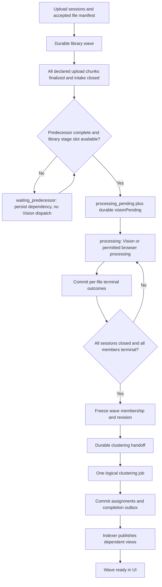

# Index ownership and end-of-processing clustering

Date: 23 October 2026 (Europe/Stockholm).

Status: target and implementation gap analysis. The first index-ownership
implementation is now in the working tree; see the delivery progress below.
An opt-in backend shadow intake/barrier foundation is also implemented locally;
browser integration, qualified source completion and sequential stage residency
remain unimplemented.
No live deployment has been performed by this work.

## 1. Required outcome and working decisions

1. The cluster app executes no published catalog/index builds, including manual
   repair, bootstrap, compaction, and legacy vector-rebuild routes.
2. Automatic clustering starts only after all photos in the current library
   processing wave have finished their required processing or reached an
   explicitly recorded terminal exception.
3. All eligible new faces in that wave belong to one logical clustering job.
   Memory-bounded chunks, checkpoints, and crash retries are allowed inside that
   job; per-photo triggers and size/time-based partial clustering are removed.
4. After assignments commit, indexer publishes the dependent views. Processing,
   clustering, and index publication have separate completion states.
5. With no foreground activity, background stages run sequentially:
   **upload intake -> Vision -> clustering -> indexing -> sleep**. No speculative
   downstream queue work, polling or warmup may keep the next app awake early.
   This scheduling requirement was clarified by the user on 23 October 2026
   and supersedes the earlier proposal to overlap Vision with upload chunks or
   publish background catalog updates during Vision.

**Agreed interpretation of “all new uploads”: a library-wide wave.** Upload
sessions that overlap before the wave is frozen join that wave, including
sessions from different tabs and shared-library members. A session starting
after the wave is frozen enters the next wave. This boundary avoids waiting for
future uploads forever. The user selected library-wide waves on 23 October
2026; per-session clustering is outside the agreed target.

“At the end of Vision” means all required processing, not just face detection.
Today the deployed processing mode is `backend`, but the protocol must accept
valid browser results as well as Vision results wherever those paths remain
supported. A processor's queue job marked `done` is not sufficient proof that
every required processing step succeeded.

Autonomous completion with the browser closed requires a backend-capable
processing mode. Pure browser-only mode cannot guarantee that progress. For
the first rollout, enable this guarantee only for qualified backend-capable
configurations; otherwise reject unsupported wave admission explicitly or
advertise a distinct browser-required state. Browser thumbnail/preview/EXIF
preparation during upload is separate from autonomous post-upload processing.

“One shot” is one logical wave job and one completion outcome, not an
exactly-once queue delivery or one enormous in-memory operation. A retry resumes
the same job. It must not create a new automatic clustering job for the same
wave revision.

## 2. Target ownership

| Owner | Owns | Must not do |
| --- | --- | --- |
| Web (`web`) | Static application/assets and explicit page loads | Maintain application residency through passive refreshes |
| Core (`core`) | Auth, gallery/photo, album/People APIs, Explore and foreground activity reads | Run background wave coordination or catalog builds |
| Upload API | Durable session membership, accepted file identities/revisions, upload close/stop/cancel signals; durable release of Vision at intake close; shared metadata-only transition evaluation with proved no-work outcomes | Decide processing completion from browser telemetry; run face matching, inference or catalog builders; fabricate worker/publication success |
| Vision / permitted browser processor | Per-photo inference, durable face/metadata results, step outcomes and completion evidence | Send per-photo automatic clustering work; build general catalog indexes |
| Stage-local control and external recovery | Current stage's durable handoff; independent bounded recovery of stranded work | Keep indexer awake as a coordinator during upload, Vision or clustering |
| Indexer maintenance worker | Search, Sort, Access, People, Albums, published photo-vector and people-embedding artifacts, upload-hash snapshots, bootstrap/compaction/recovery | Consume clustering work or run face assignment |
| Cluster worker | One wave's face-to-person assignment/discovery, authoritative assignment/person writes, internal FAISS runtime and checkpoints | Build/publish Search, Sort, Access, People/Albums snapshots, hash snapshots or published vector artifacts |
| Recovery app (`recovery`) | Existing manual repair API (`admin_bp`); target authenticated wave inspection and audited retry/cancel/repair requests | Become a permanently polling coordinator or automatically run destructive repairs |
| Archive app (`archive`) | Library management/export/clean orchestration and public-share endpoints (`library_bp`, `public_bp`) | Be treated as idle when export/share/library requests actually need it |
| Serving APIs and browser | Read published views, submit mutations, request maintenance, show stage progress | Repair an index synchronously on a read |

### Complete app-role inventory and recovery terminology

There are eight deployed app identities: **web, core, upload, indexer, recovery,
archive, cluster and Vision**. Backend `APP_ROLE` values match those names except
web, which serves the frontend image. `index-worker` is an additional backend
process role proposed as a sidecar inside the existing indexer app, not a ninth
application. `entrypoint.sh` selects worker entrypoints; the HTTP blueprint
registration lives in `app.py`'s role-dispatch block.

Use **Recovery app** for the existing HTTP-scaled `APP_ROLE=recovery` app hosting
`admin_bp`. Use **automated wave recovery** for bounded stranded-work scans,
outbox replay, completion evaluation and successor promotion. They are different
execution responsibilities even when they reuse protocol code.

**Target hosting choice:** keep automated wave recovery deliberately separate
from the Recovery app's HTTP lifecycle, as scheduled, bounded job execution that
can return to zero. Reuse the backend image/shared recovery modules where
practical, not an always-running scanner thread in the Recovery app. A periodic
HTTP ping to that app every five minutes would consume its cooldown and undermine
the sleep contract. The scheduled job is additional execution infrastructure;
its exact deployment configuration, resource budget and identity are still to
be specified, but whether it lives inside the Recovery HTTP app is no longer an
unanswered question.

The Recovery app remains the human-facing inspection/repair entrypoint and can
call the same conditional protocol functions on explicit requests. Existing
`_enqueue_admin_repair_job`/cluster dispatch is a legacy path, not a reason to
route automated wave scans through cluster. Index repair requests route to
indexer; assignment/curation repairs route to cluster; safe wave handoff repair
uses the shared transition engine. Existing non-index library operations remain
explicit exceptions until separately migrated.

The scheduled scanner uses a dedicated workload identity and narrowly scoped
storage/queue permissions, not a human session or blanket access to dangerous
HTTP admin actions. It may reconcile/relay eligible durable work under the
documented fences; it cannot infer consent to recluster, purge or bypass source
curation. Monitoring can inspect scan freshness without making readiness probes
that keep the Recovery app or other application apps alive. All references below
to external/independent recovery mean this bounded scheduled execution.

The internal FAISS lookup and its checkpoint are part of the clustering
algorithm and stay with cluster. Moving those out would make assignment depend
on a remote retrieval service and is a different project. Likewise, transactional
face-to-filename lookup maintenance belongs with authoritative face writes;
it is not a general catalog rebuild. Cluster may update the authoritative
per-photo face/person fields required by today's data model, then emit durable
projection intents; it must not use those callbacks to publish library indexes.

Tag-embedding inference remains model-owned by Vision for this migration.
The existing CLIP-derived tag artifact is an explicit model-owned exception,
never cluster work. If all artifact publication must eventually be centralized
in indexer, split model output production from artifact assembly in a separate
step; do not generate fallback embeddings in the lightweight indexer image.

The existing indexer app can host the Tools API and maintenance sidecar already
described in `index-maintenance-migration.md`. It handles publication work only
when the indexing stage or an explicit foreground mutation authorizes that work.
Upload closes intake and releases Vision; Vision owns its completion barrier
and clustering handoff; cluster commits the indexing handoff. Shared protocol
modules enforce these transitions without a continuously running coordinator.
Recovery and monitoring execute outside these apps as bounded independent work;
their hosting and cost are a deployment design requirement, not a hidden
always-awake indexer loop. Existing export/delete/repair
library operations can remain on cluster during this migration, but indexing
and upload-release orchestration cannot. Thus cluster may still wake for an
explicit export or repair before Vision drains; automatic upload clustering may
not start early. Making cluster exclusively a clustering service is additional
scope and requires relocating those operations too.

## 3. End-to-end flow



Processing writes source metadata and durable projection intents without waking
indexer. The final indexing stage publishes those deferred changes along with
assignment-dependent views. Active user mutations may request narrowly scoped
incremental publication as an explicit foreground exception; they cannot drain
all deferred wave work or announce the wave complete. Final People and dependent
search views identify the completed clustering revision they cover.

### App residency and five-minute cooldown

For an otherwise idle deployment, the intended steady state is:

| Work stage | App doing work | Other apps after their idle cooldown |
| --- | --- | --- |
| Upload intake, including all queued 900-file chunks | Upload API as registration/finalization requests arrive; bytes flow directly to storage | Core, Vision, cluster, indexer, archive and recovery at zero |
| All intake closed; required processing underway | Vision | Upload at zero after its last request drains and five-minute idle cooldown; core, cluster and indexer at zero |
| Processing complete; assignments underway | Cluster | Vision at zero after work drains and five-minute idle cooldown; upload, core and indexer at zero |
| Assignments committed; projections publishing | Indexer | Cluster at zero after work drains and five-minute idle cooldown; Vision, upload and core at zero |
| All work complete; user still inactive | None | All application apps at zero after their idle cooldown |

Outside that automatic sequence, the Recovery app wakes for an explicit
inspection/repair API request, then cools down; automated wave scans run in the
separate bounded job. Archive wakes for library-management/export/clean or public
share requests, including authorized external viewers. Public media streaming
can legitimately keep archive active even when the uploader is inactive.
Web wakes for actual page/asset delivery. These independent workloads override
the single-inactive-user residency example; they are not wave-stage dependencies.

The predecessor can remain present during its cooldown while its successor
starts. Do not impose five minutes of artificial handoff delay merely to avoid
that temporary overlap. Five minutes is the target idle cooldown after the last
qualifying request/work, not a promise to terminate a live task exactly five
minutes after a state transition. Configure and verify each app's scale-down
behavior in deployment; the current templates do not establish this contract.

### Watching a desktop upload from another device

An authenticated phone opening the library is foreground demand: web serves the
page and core can read a small persisted per-operation activity summary. Do not
wake indexer, cluster or Vision merely to discover upload progress. Poll core
only while the progress view is visible and the user is active, with an initial
proposed interval of 30 seconds; stop on inactivity/navigation/terminal status
and catch up on explicit return. Static web delivery does not need periodic
requests just because core is polled.

The desktop writes a rate-limited session/parent summary through upload, sharing
its existing active-transfer heartbeat: declared/resolved item totals, finalized
files/bytes, duplicate/failure/cancel counts, latest useful progress and latest
contact. Optional acknowledged in-flight bytes/speed are labeled client-reported;
finalized counts come from durable acceptance. The parent spans all 900-file
chunks. Consolidate desktop updates per parent rather than per transfer lane,
and version summaries so a delayed heartbeat cannot regress counters or overwrite
an authoritative closed/complete state. Core uses bounded point reads, not Blob
enumeration or metadata scans, with normal shared-library authorization.

Expose `uploading`, `finalizing`, `stopped by user`, `completed intake`, `failed`
and `contact lost / progress unknown` distinctly, followed by the actual wave
stage. Silence cannot prove a deliberate stop: screen lock, OS sleep, network
loss and a suspended browser can all stop heartbeats. Set freshness thresholds
from the configured heartbeat cadence with browser-throttling allowance and show
"last contact". A stalled heartbeat must not itself close intake or release
Vision. The current 90-second transfer heartbeat records recency only, not a
complete cross-device progress summary.

At a 30-second poll interval, ten minutes of watching adds about 20 status
requests (plus initial/catch-up), summary reads and existing auth checks. Desktop
summary writes are separately rate-limited; reading from another device must not
increase their frequency. Core's extended residency plus cooldown is a separate
cost from the small status payload. Exact currency cost needs current hosting
rates and measured replica behavior; this request arithmetic is not an Azure
price quote. A phone leaving the view adds no continuing status polling.

"All apps sleep during upload" means all unrelated apps: upload endpoints still
need a replica to issue URLs/register/finalize. During a long direct-to-storage
transfer, even upload can be idle between requests. Web may briefly serve the
page/assets and should have no server dependency merely to keep the loaded page
open. Necessary auth or foreground reads can briefly wake core.

Foreground work is additive: gallery/API requests wake core; upload requests
wake upload; album/People CRUD wakes the owning API and, when its projections
change, scoped incremental indexer work. Merely viewing the gallery must not
start unrelated background rebuilds. Static web delivery, public shares,
exports, repairs and other explicit features wake their owning apps as needed.
An app returns to zero after its last useful work and cooldown. This is
demand-driven residency, not a permanent replica while a tab is open.

Implement background stage eligibility in durable state before making queue
work runnable. Merely persisting deferred intents must not expose messages to a
downstream scaler. Browser job polling, warmup, pending-processing polls,
keepalives and internal HTTP health probes must stop when unnecessary; an idle
loaded tab cannot keep core/upload/indexer alive through periodic requests.
Push is not automatically exempt: current `indexReadyPush.ts` retries unavailable
negotiation every minute and renews an available connection after four minutes.
Gate negotiation/reconnect/catch-up HTTP by the same foreground-demand policy;
otherwise push can keep indexer awake even after job polling stops.
Enforce eligibility again in worker claims, recovery and legacy dispatch: an
HTTP request can start the indexer API and its co-located consumer together.
Scope-only library maintenance keys do not prove wave coverage. Persist exact
wave/assignment publication receipts and separate eligible foreground patches
from deferred background intents; foreground edits must not release every
dirty row in the same scope. Preserve authoritative duplicate detection when
the upload-hash snapshot is intentionally deferred until final indexing.
No-clusterable-face waves skip cluster only when no assignment/membership
removal, person repair or other cluster-owned reconciliation remains. Zero
new detections after reprocessing do not prove zero clustering-stage work.
Indexing may likewise complete without a worker wake if there is no required work.

These residency expectations assume no other library or previously requested
operation needs those shared apps. Per-library sequencing cannot guarantee
deployment-wide zero while other users have work. Serialize automatic background
waves within a library: intake for a successor can be accepted while the current
wave finishes, but its Vision stage waits for the predecessor's indexing stage.
New uploads during an unfrozen Vision wave reopen intake, suspend further
automatic processing dispatch, and prevent clustering until intake closes and
all required processing settles again. Already leased work drains safely;
renewed upload activity does not undo committed results or abort live tasks.

## 4. Durable data and state transitions

These are proposed logical records, not names already implemented in storage.
Use dedicated protocol modules rather than extending the shared globals in
`app.py`.

### Upload session and file registration

- Persist `sessionId` across retries/resume. Keep telemetry `uploadBatchId`
  separate: it currently changes for a new upload run and has no authoritative
  completion contract.
- Register each intended session item with a stable client item key before
  processing can complete. Bind accepted items to immutable photo identity and
  a processing revision, not filename alone. Finalized names can change during
  duplicate/name resolution.
- Session state: `open -> closed` or `abandoned`. Its accepted manifest becomes
  immutable on closure. Stop closes the accepted subset; a later resume creates
  a successor intake session linked to the original client session. Failed or
  unuploaded selections are recorded separately from accepted processing work.
- Make registration/finalization idempotent. Duplicate uploads refer to existing
  processing evidence if applicable; they must not increase the barrier twice.
- A client close request closes intake only. It never asserts Vision completion.
  It includes an idempotency key and a manifest revision/digest so a delayed close
  cannot omit an accepted file. Any in-flight reservation must be resolved before
  closure succeeds.
- For crashes or lost close signals, a durable deadline starts reconciliation.
  Resolve reserved uploads against durable upload/blob evidence, close the
  accepted subset, and record abandonment. Quiet time alone cannot prove that a
  large direct-to-blob transfer has finished.

### The existing 900-file upload chunks and successive selections

`MAX_FRESH_UPLOAD_BATCH_SIZE=900` in `AppServicesProvider.tsx` still splits
large picker selections into deferred upload sessions. The next queued session
starts after the current session's finalize/retry tail clears. This is a client
resource-management boundary, not the intended clustering boundary. Other
entry paths can call `startUpload` directly; 900 is not a universal backend
limit. Init/finalize API requests have a separate 20-file maximum.

Keep upload chunking, but introduce a durable parent upload operation for the
whole selection/queued chain. Register its declared chunks or manifest before
starting the first chunk; close the parent only when all chunks are resolved.
For example, 2,700 selected files may upload as 900 + 900 + 900, while remaining
one open intake operation and ultimately one clustering wave. Neither Vision
nor clustering starts at the end of chunk one while later chunks are queued.
Parent/manifest registration can
be paginated; a partial registration cannot close intake.

A new selection made while upload/processing intake remains open is admitted
to the collecting library wave, including files waiting in the client queue.
Register that admission durably when the selection is accepted, rather than
waiting until its first upload begins. Otherwise queued files are invisible to
the server's barrier. Lost client-only selections must surface as unresolved or
abandoned intake, not silently vanish from declared membership.

Separate back-to-back selections cluster together when admitted before the
wave freezes. Once `ready` freezes a wave, later selections enter the successor
wave even if the earlier clustering job has only just started. No protocol can
wait for an undeclared future selection indefinitely; an optional explicit
"add more uploads" open-intake mode would need its own close/abandonment rules.

### Per-photo processing evidence

For each accepted `(photoId, processingRevision)`, retain wave membership,
required step set, compatible face model version, persisted face-result/lookup
revision, step outcomes, and remaining retry state. Zero-face photos count toward
the barrier even though they generate no assignment input.

Terminal outcomes:

| Outcome | Barrier treatment |
| --- | --- |
| Required steps persisted successfully; legitimate `no_data` | Settled; eligible compatible faces join clustering |
| Video or unsupported step/media excluded by policy | Settled with explicit exclusion; no invented face work |
| Deleted/cancelled accepted photo | Settled with tombstone/cancellation revision |
| Retryable failure, pending work, or a live processing lease | Not settled |
| Retries exhausted | Settled with an explicit failure; wave may cluster successful members and report partial completion |
| Stale result from an older processing generation | Cannot settle or overwrite the current generation |

This proposal allows a partially successful wave to cluster once after failures
are exhausted, with visible failed counts. Retrying those failed photos later
creates a successor wave. It must not silently reopen an already completed wave.
A stricter product policy can block the wave for manual repair instead, but must
show that state and never misreport complete success.

Persist completion evidence only after face rows, filename lookup and processing
metadata are durable and mutually consistent for the relevant revision. A queue
acknowledgement, a telemetry event or `ipwork` job status alone is insufficient.

### Library wave

State: `collecting -> waiting_predecessor (when necessary) -> processing_pending
-> processing -> ready -> clustering -> assignments_committed -> indexing
-> complete`, with explicit `blocked`, `failed` and partial-result details.
`ready` means processing is complete and clustering can be released; it never
means ready to begin Vision.

| State | Durable meaning | Permitted automatic work |
| --- | --- | --- |
| `collecting` | Intake declaration/reservations remain open | Upload only; previously leased processing may safely drain if intake reopened |
| `waiting_predecessor` | Intake closed, but predecessor publication/completion or library stage-slot release is not yet confirmed | No successor Vision/cluster/index dispatch |
| `processing_pending` | Intake closed, predecessor dependency satisfied and library stage slot reserved for this wave; Vision handoff exists | Relay eligible `visionPending`; no downstream cluster/index work |
| `processing` | Valid processing claim accepted, or validated stage evaluation is resolving zero-work inputs | Required processing and completion evidence |
| `ready` | Captured input settled; clustering/removal work or a proved no-op handoff is pending | Relay `clusterPending` or its explicit no-op advancement |

Persist `predecessorWaveId`, `predecessorRequiredRevision`,
`predecessorWaitStartedAt`, `predecessorSatisfiedAt` and a bounded `waitReason`.
The library control record maintains an ordered admission lineage and the active
background wave/epoch. A successor may be collecting while its predecessor is
active; after intake closes, it enters `waiting_predecessor` rather than looking
like Vision capacity is missing. The first wave has no predecessor dependency.

The predecessor's `complete` receipt must cover its required publication
frontier. `assignments_committed`, a queue acknowledgement, a cooldown expiry or
an arbitrary scope's `done` record cannot release the successor. A failed or
blocked predecessor remains an explicit dependency blocker; operator recovery
must repair it or perform an audited compatible ownership transfer, never
silently bypass it. A completed-with-errors wave can release its successor only
when its permitted partial outcome and all required publication receipts are
committed.

Predecessor completion durably records successor-promotion work. The completing
indexer can attempt promotion; independent recovery guarantees it if that
attempt is lost. Promotion conditionally reserves the library stage slot for
the next closed wave and persists its `processing_pending`/`visionPending`
transition. If these records cannot share a transaction, use a recoverable
reservation keyed by wave/epoch; consumers verify both sides before claiming.
Repeating promotion cannot skip a wave or grant two automatic stage owners.
An open next intake retains its order without waking Vision prematurely.

Reopened admission before clustering freeze invalidates old processing-release
eligibility by intake revision/epoch and returns the wave to `collecting`.
Existing results remain valid where their member revision matches. Old queued
Vision wakeups cannot claim new work against the closed-intake revision after
it has been reopened. Closing again creates a revision-specific release, not a
second logical wave.

The collecting wave accepts overlapping intake sessions while processing is
underway. Readiness requires:

1. Every member intake session is closed/abandoned and its accepted manifest is
   resolved.
2. Every distinct accepted processing revision is settled under the policy above.
3. No required result is still being committed or held by a live lease.
4. Authoritative registration/completion evidence agrees at a captured revision.

Use conditional writes on one library control record to serialize session
admission against the transition to `ready`. That transition freezes membership,
captures a manifest reference/digest and allocates an immutable wave revision.
A concurrent intake either joins before the freeze and prevents premature
readiness, or joins the successor wave. It cannot be omitted from both.

Keep the control record and admission protocol within a suitable partition or
use a recoverable reservation protocol; do not assume atomicity across arbitrary
source, session, work-ledger and queue writes. Counts are cached summaries of
idempotent member records, not the only evidence. Partitioned/chunked manifests
avoid a giant table entity or queue payload. Readiness validation must be
paginated and resumable for large imports.

### Handoffs and recovery

- **Shared outbox contract for all three handoffs:** `visionPending`,
  `clusterPending` and `indexPending` identify `(library, wave, input revision,
  destination stage)` with manifest/dependency references, eligibility epoch,
  pending timestamp, attempt/retry state and dispatch/claim evidence. Persist
  the handoff with the source stage transition, or retain a source-side pending
  marker that deterministically reconstructs it. Never depend on a successful
  HTTP response or in-memory callback to remember the next stage.
- **Intake close -> Vision:** when intake closes, persist its accepted frontier
  and either the `waiting_predecessor` dependency or eligible
  `processing_pending` plus `visionPending`. Upload is the normal producer;
  predecessor promotion produces the latter transition for a waiting successor.
  The relay sends only after validating intake closure, predecessor receipt and
  library slot/epoch. Reserve dispatch conditionally, send a small manifest
  wakeup, and record dispatch against that same revision. Send failure or crash
  retains/reconstructs pending work; recovery retries with backoff. Vision checks
  eligibility again and claims a renewable fenced owner before processing.
  Duplicate sends resume the same release/member work. A no-op processing stage
  persists verified completion and the next handoff without requiring a Vision
  replica merely to announce that nothing is needed.
- Readiness persists `clusterPending` together with the frozen wave transition.
  A relay sends a small message containing library, wave, revision and manifest
  reference. Mark it dispatched conditionally. Failure between commit and send
  is recoverable without re-running Vision.
- Cluster claims the wave with a renewable owner lease and fencing token. It
  validates source revisions and current curation before each bounded write.
  Duplicate deliveries resume/observe the same job. An older lease holder may
  not publish completion after ownership changes.
- A partially written assignment attempt resumes idempotently. Persist chunk
  progress and expected source revisions. Expired leases and crashes must not
  require starting a new logical wave job.
- After all assignment writes and today's required source projections are
  confirmed, commit `assignments_committed` plus durable `indexPending` (the
  **index outbox**). This outbox is the indexer-release mechanism, not a separate
  undocumented signal. Its manifest contains exact required projection scopes
  and source/assignment revisions. Relaying it schedules those obligations,
  records per-obligation dispatch/claim evidence, and retains unsent work until
  repaired. A crash after assignment completion or a partial fan-out send is
  recovered from the same outbox without new assignment work. Indexer validates
  the committed assignment outcome and claims eligible obligations; duplicate
  dispatches are idempotent. Deferred/failed projection work cannot be treated
  as an acknowledged complete handoff.
- Index publication records the covered assignment/wave revision. A wave becomes
  `complete` only when all required projection receipts cover that revision.
  Later unrelated edits do not require the library to become globally idle.
- Recovery scans only outstanding control/outbox work in bounded pages, retries
  with backoff, and surfaces exhausted jobs. Independent recovery evaluates
  durable stage eligibility and wakes only the owner of actionable work. It must
  not wake indexer to coordinate upload/Vision/cluster. Zero running application
  replicas plus a failed queue send cannot strand a pending wave indefinitely.
  It also retries lost successor promotion. A `waiting_predecessor` record is
  not an overdue runnable Vision outbox: alert against its dependency, not a
  Vision scaler that correctly has nothing eligible to consume.

### Additional transition contracts

**Dispatch acceptance is not work completion.** Each handoff tracks its own
lifecycle: `pending -> dispatch_reserved -> dispatched -> claimed -> completed`,
with deferred/retryable/exhausted outcomes. A queue-send success cannot permanently
clear the recovery obligation. If no valid claim arrives, or a claim expires
before completion, recovery reissues the same identity after validating current
eligibility. Queue TTL expiry, dead-lettering and a consumer crash after queue
acknowledgement must remain recoverable from the ledger. A valid live claim or
intentional predecessor hold does not create another delivery/retry storm.

**Vision fan-out is itself durable work.** If the manifest wakeup produces
per-photo/step queue messages, persist a paginated fan-out cursor or idempotent
per-member dispatch records. Crash after sending the first page cannot leave
later members permanently unqueued. Per-member keys include photo/processing
revision and required steps; duplicates do not multiply logical work. A root
wakeup is acknowledged only after dispatch progress is durably recoverable.
The completion barrier uses settled member evidence, never the cursor reaching
the end or all messages being sent. Define who resumes fan-out when no photo
worker has yet started: the eligible Vision dispatcher or independent recovery,
without waking cluster/indexer.

**Admission fencing and result fencing are different.** Reopening intake revokes
permission to claim additional wave work, not permission for an already leased
processor to commit a valid result for an unchanged member revision. Track the
intake eligibility epoch, stage-owner epoch and photo/source processing revision
separately. An old processor can settle its unchanged source member under a
still-valid source lease but cannot advance the wave barrier using a stale
intake frontier. Source replacement, deletion or source-lease loss still rejects
the stale result. A single reused "wave revision" must not cause legitimate
in-flight work to be discarded or let late results release clustering early.
Reopening must also quiesce/release or supersede the old **dispatch-controller**
claim. Retaining that claim when returning to `processing_pending` can prevent
both re-dispatch and controller recovery. Its release must not revoke valid
per-photo source leases. Persist enough paused-controller state for recovery to
finish this separation after a crash.

**Final publication, completion and slot release need a recoverable join.**
The last required publication receipt creates a durable completion-evaluation
obligation. Its evaluator verifies the captured finite obligation set, commits
the final outcome, then releases/transfers the library stage slot and records
successor promotion. If these writes are not atomic, recovery recognizes each
intermediate state by expected wave/epoch. Crash after the last receipt but
before `complete` cannot strand a fully indexed wave; crash after `complete`
but before slot release cannot block successors forever. A delayed predecessor
cannot clear a slot already owned by its successor. Foreground edits arriving
after the captured wave frontier create separate obligations rather than
extending the wave's completion set indefinitely.

**Zero-work advancement is control metadata, not worker execution.** Upload's
close handler, the current stage owner and the independent scheduled scanner
are explicitly authorized to invoke one shared conditional transition engine.
This permission includes recording `outcome=no_work` and library-slot promotion;
it excludes running face matching, inference, catalog builders or manufacturing
receipts that assert those workers produced an artifact. This is the permitted
ownership boundary, including when Upload is the last app awake.

Persist stage outcomes separately from worker status: `no_work` has a proof
reference, while `applied` has the destination owner's result/receipt. The
`assignments_committed` milestone accepts a validated terminal assignment
outcome of either kind; its name does not assert face writes occurred. Empty
projection obligations require no publication outbox or fake artifact receipt.
The shared engine may complete/promote a fully empty wave directly.

A no-work witness binds the sealed input manifest/revision, library slot epoch
and authoritative obligation-set digest. Processing no-work proves every
required member step is already valid or explicitly excluded; assignment
no-work proves both eligible face work and removal/repair obligations are empty;
indexing no-work proves the captured projection obligation set is empty. An
empty selection counter, queue absence or a stale hash-snapshot hit is not proof.
If evidence is unavailable, disagreeing or incomplete, retain a blocked/evaluation
obligation for independent recovery; never assume no-work. Conditional witness
commit must fail if admission/source obligations changed since evaluation.
For all-duplicate uploads, preserve any new upload/hash/source obligations;
"already processed" alone does not prove indexing is unnecessary.

The close handler is the normal producer of empty-wave transitions; the
scheduled scanner is the guaranteed crash fallback, so no skipped worker app
must be awakened merely to advance state. Partial outcomes, tombstones and
membership cleanup remain explicit obligations.

**Stale signals are not new work or fresh failures.** A stale intake-epoch
wakeup is acknowledged/discarded after recording why it is obsolete; it cannot
increment the current revision's attempt count, mark its new outbox failed or
reschedule itself forever. Keep terminal wave receipts or a retirement frontier
long enough to reject old messages after detailed records are collected. Library
deletion/restore must invalidate old protocol ownership and cancel its lineage;
recovery cannot recreate deleted source data or promote a successor from a
retired library generation.

## 5. Clustering semantics

One frozen wave includes all its eligible newly processed faces. Match them
against established people and discover identities among the wave's unmatched
faces, preserving existing named/sticky assignments and user rejections.
Do not automatically run a full-library DBSCAN recluster for every upload wave.

**Top release blocker: partition-independent identity assignment.** The initial
algorithm is a wave-wide deterministic sequential assignment pass using the
existing live FAISS matcher, not separate per-chunk identity discovery. Freeze
compatible face revisions, order them canonically by `(compatibility group,
canonical photo identity, face identity)` and retain that ordering in the wave
manifest. Thresholds, margin, model/tier rules and candidate configuration are
captured with the job. Each newly accepted assignment becomes a candidate for
all subsequent compatible faces in the wave, including later chunks. Chunk
boundaries never reset the candidate universe or person-creation namespace.
Person creation uses deterministic identity tied to the initiating face, not
random per-attempt/per-chunk IDs.

This algorithm can match a chunk-3 face to the person established in chunk 1
without a separate union pass. It does not guarantee every face of the same
human will pass the similarity/margin rule, and it does not promise arbitrary
input-order invariance. Its correctness contract is the same decisions as a
qualified single-pass reference over the fixed canonical order, independent of
chunk partition and resume boundary. That reference must exist as an executable
test oracle, independent of the chunk/resume orchestration, and the release
tests must assert their actual outputs against it on identical frozen inputs;
an assertion that two scenarios merely completed is insufficient. The initial
oracle is `backend/tests/clustering_reference_oracle.py:run_single_pass_reference`,
which runs the real matcher uninterrupted in canonical order. Its fixture also
asserts known identity relations. Extend this oracle to the eventual wave
manifest/configuration/decision-journal API before release; do not silently
update expected outputs to match a changed chunked implementation.
Unconditional cross-chunk union is not a
safe substitute: it could merge distinct/confirmed identities through an
ambiguous similarity chain. Global graph discovery or DBSCAN is a separate
algorithm change requiring its own quality approval, not an unspecified fallback.

Before each authoritative assignment mutation, persist its deterministic
decision under a wave/face-revision decision key, including expected source
revision, selected/new person ID and captured matcher configuration. A staged
chunk must durably journal its complete plan before publishing its staged
writes. Retry applies/resumes recorded decisions rather than rematching
partially written chunks against their own newly committed candidates. Changed
curation/source state invalidates an unapplied decision under its fence and
requires an explicit protected/superseded/replanned outcome; never overwrite
the user's edit. Decision progress, source writes and runtime checkpoint coverage
are distinct frontiers and must be reconciled before continuing.

### Runtime replay and checkpoint idempotency

The current implementation is not a raw append-only FAISS index:
`clustering_runtime.LiveFaceIndex` has SQLite `UNIQUE(face_id)`, revisioned
upsert/base/delta mappings and query filtering that excludes obsolete slots;
`best_two` aggregates distinct person identities. `FaissAssigner.assign` skips
already-owned faces, invalidates unsafe runtimes and only publishes safe
checkpoints. These mechanisms already mitigate the proposed ghost-duplicate
failure; the review has not demonstrated that bug in the current code.

Nevertheless, repeated `LiveFaceIndex.upsert` calls currently append native delta
slots even for the same face and advance its local revision. Logical uniqueness
is not physical replay idempotency. The target requires:

- Use the revision-aware wrapper, never raw FAISS insertion. Replay of an
  identical `(face identity, source generation, embedding/model, owner decision)`
  is a logical no-op and must avoid unnecessary new native slots. A changed
  owner/vector/model replaces the current logical revision; obsolete slots
  cannot participate in matching or distort distinct-person margins.
- Checkpoint metadata includes library/source generation, model/configuration,
  decision-journal coverage and runtime/source commit frontier. Restore validates
  those references. An older checkpoint catches up from committed decisions;
  a checkpoint ahead of authoritative commits is rejected/rebuilt. A job cursor
  never authorizes skipping source-to-runtime catch-up.
- Partial/staged failure invalidates private runtime changes before any new
  query/checkpoint. Do not checkpoint uncommitted candidate exemplars or restore
  them as accepted assignments. If trusted reconciliation cannot establish
  coverage, rebuild from valid committed source/decision evidence.
- Assert one current logical face revision and correct person ownership across
  replay, with unchanged decisions/candidate scores and bounded native slot
  growth. Physical obsolete slots may exist by design, but compaction thresholds
  and candidate filtering must prevent replay amplification from changing results.

Release tests compare one chunk, many chunks, checkpoint/restart at every chunk
boundary and crashes between plan/runtime/source/projection commits. Include
same-person matches across nonadjacent chunks, distinct-person runner-up margins,
repeated identical face replays and model/owner changes. Test identity grouping
and protected assignments, not just row uniqueness/job completion.

Internal chunks are implementation details: one job identifier, one input
manifest and one cumulative outcome. Chunk size cannot release an early job
while Vision is still processing the wave. Checkpoint/rebuild of the internal
FAISS runtime is allowed; catalog publication remains indexer's responsibility.
Automatic work is serialized per library. Manual clustering/merge/reassign
actions must share the mutation fence; an explicit manual override is visible
and cannot falsely complete a still-processing automatic wave.

## 6. Verified current state

### Repository

Assessed clean checkout `55d881f1da62ceee207578f73e46ac1eda2e5066`.

| Area | Current evidence |
| --- | --- |
| Dedicated index consumer | `run_index_worker`, durable scopes, revision-aware work ledger and conditional publication exist. Bicep defaults `dedicatedIndexWorker=true` and adds a sidecar in indexer. |
| Legacy cluster execution | `enqueue_index_build` sends to library-ops when the maintenance queue setting is absent. Cluster dispatch calls `_run_index_build_job`; dedicated mode instead forwards legacy `index_build` messages. |
| Other index entry points | Admin vector rebuild queues `vector_index_rebuild` to cluster, whose handler directly calls `refresh_user_vector_index`. This bypasses the generic index-build bridge. Build-role defaults include cluster and Vision; role checks on read helpers do not enforce every direct publisher. |
| Per-photo face trigger | `_handle_ipwork_queue_payload_impl` invokes `_queue_people_clustering_after_face_processing` after face execution. Upload/browser paths also use this hook. It buffers assignment inputs; default assignment engine is FAISS. |
| Producer batching | Per-process/per-library buffers flush at 1,500 faces, a 15,000-filename safety cap, five-minute oldest-pending/idle limits, manual request or shutdown. Checkpoints are best effort. No global completion barrier exists. |
| Cluster batching | Incremental messages contain at most 128 filenames; the consumer accumulates messages and uses bounded FAISS work groups, including a 256-face staged path. These are transport/execution batches, not a closed upload cohort. |
| Upload end / Vision release | `/upload/known-hashes/refresh` schedules dedup and `ipwork_release` on library-ops. Delayed release checks also use library-ops, so cluster participates before processing completes. Deferred release scans pending library metadata rather than an immutable wave manifest. |
| Existing identifiers | Frontend persisted upload sessions and telemetry batch UUIDs exist. `processingBatchId` is stamped on metadata, but there is no durable batch manifest/closure/completion ledger. Deferred release has no per-wave contract. |
| Completion evidence | Processing applies results under per-photo leases. The Vision job can be marked `done` after apply even when individual results contain failures; the code explicitly distinguishes this from its stricter productive metric. |
| Publication triggers | Vision requests light index refreshes at processing milestones and local drain; cluster source writes emit invalidations/intents, and some clustering jobs request People refresh. No wave-level publication receipt joins these into one outcome. |

Source anchors (function names are preferred over drifting line numbers):

- `backend/app.py`: `enqueue_index_build`, `_run_index_maintenance_payload`,
  `_handle_clustering_queue_payload`, `run_index_worker`, `run_clustering_worker`.
- `backend/app.py`: `_queue_upload_processing`, `_release_deferred_ipwork`,
  `_run_ipwork_release_check_job`, `_handle_ipwork_queue_payload_impl`,
  `_queue_people_clustering_after_face_processing`,
  `_buffer_incremental_assign_filename`, `_flush_stale_incremental_assign_buffers`,
  `_process_clustering_user_group`, `_live_faiss_metadata_update`.
- `backend/storage_utils.py`: `index_build_allowed`,
  `prepare_metadata_index_intent`, `publish_metadata_index_intent`, the
  `refresh_user_*` entry points; `backend/index_work.py`,
  `backend/index_publication.py`, `backend/index_updates.py`.
- `backend/routes/admin.py`: `admin_rebuild_vector_index`; `backend/routes/upload.py`:
  `refresh_known_upload_hashes`; `backend/processing_diagnostics.py`: `upload_fields`.
- `frontend/src/components/AppServicesProvider.tsx`: persisted upload sessions
  and per-run `uploadBatchId`; `backend/faiss_assignment.py`: `FaissAssigner`.

### Live deployment, captured read-only snapshot

Read-only Container Apps inventory from `forenklaprep1-dev-rg`, collected around
23 October 2026 01:00 Stockholm time (22 October 23:00 UTC). This supersedes the
older deployment observations in the 22 October indexing audit. It is a
configuration inspection, not an end-to-end processing or queue-drain test.
The captured query returned all eight apps; the initial write-up selected only
the three workers involved in indexing. The expanded inventory below uses that
same timestamped response, not a new live inspection.

| App | Observed configuration |
| --- | --- |
| Web | Frontend image `55d881f…`, ready revision `--0000009`; 0.25 CPU / 0.5 GiB; min 0 / max 2; no custom rules in the captured scale configuration. |
| Core | Backend image `55d881f…`, ready revision `--0000008`; 0.5 CPU / 1 GiB; HTTP scaler; min 0 / max 5. |
| Upload | Backend image `55d881f…`, ready revision `--0000008`; 0.5 CPU / 1 GiB; HTTP scaler; min 0 / max 5. |
| Indexer | Image `55d881f…`, ready revision `--0000008`; one HTTP `indexer` container, 2 CPU / 4 GiB; HTTP scaler only; min 0 / max 2. No maintenance sidecar. |
| Recovery | Backend image `55d881f…`, ready revision `--0000008`; `APP_ROLE=recovery`, 0.5 CPU / 1 GiB; HTTP scaler; min 0 / max 2. `admin_bp` is registered by repository role dispatch; no automated wave scan loop is implemented. |
| Archive | Backend image `55d881f…`, ready revision `--0000008`; `APP_ROLE=archive`, 0.5 CPU / 1 GiB; HTTP scaler; min 0 / max 3. Repository role dispatch registers `library_bp` and `public_bp`. |
| Cluster | Image `55d881f…`, ready revision `--0000010`; 1 CPU / 2 GiB; min 0 / max 1; both clustering and library-ops queue scalers; shutdown grace 600 seconds. |
| Vision | Image `55d881f…`, ready revision `--0000009`; 2 CPU / 4 GiB; min 0 / max 1; queue scaler and periodic sweep wake; `IPWORKER_CONCURRENCY=2`. |
| Producer/worker settings | `PROCESSING_MODE=backend` on upload, cluster and Vision. Neither `INDEX_MAINTENANCE_QUEUE_NAME` nor `INDEX_BUILD_ROLES` appeared on any app in the filtered inventory. Face batching settings and assignment-engine overrides were absent, so image defaults apply. |

Therefore the live environment still uses legacy index ownership. The Bicep
default is not evidence that the sidecar/durable producer mode is deployed.
No fresh queue/table inspection or mutation traffic was performed in this pass.

## 7. Delta from current state to target

| Priority / gap | Already available | Required change | Completion evidence |
| --- | --- | --- | --- |
| P0: remove live catalog builds from cluster | Dedicated consumer, Bicep sidecar, scopes and bridge | Deploy producer/consumer settings together; change defaults to indexer ownership; prohibit cluster publishers at direct entry points | Actual indexer queue consumer processes scopes; cluster logs zero catalog builds |
| P0: close bypass routes | Generic legacy-message bridge | Route manual vector rebuild and every repair/bootstrap publisher to indexer; inventory transitive helper calls, not only `index_build` | Runtime boundary tests fail if cluster calls any catalog publisher |
| P0: durable intake and wave membership | Local session IDs, metadata batch label, upload status | Add server session/manifest protocol, revisioned admission, close/abandon reconciliation and library wave | Resume, overlapping sessions, in-flight finalize and tab loss cannot drop members |
| P0: global processing completion | Per-photo leases and statuses | Add durable per-revision evidence for every member, including zero faces/failures/exclusions; define all required steps | One slow photo or live lease prevents readiness across all replicas |
| P0: replace early clustering triggers | Incremental assignment and buffered transport | Record results into wave; remove automatic face-count/time/manual/shutdown buffer releases for wave-managed work | Large and long imports enqueue no automatic cluster job before readiness |
| P0: one wave job with resumable execution | FAISS runtime, leases, checkpoints, idempotent assignment | Manifest-based job, wave fence, bounded chunks, durable progress and deduplication | Duplicate sends/crashes resume one logical job; faces across chunks are covered |
| P0: durable assignment-to-index handoff | Source intents and index work ledger | Persist completion outbox, assignment revision and projection receipts | Crash after assignments cannot leave People/Search permanently stale |
| P0: automatic repair while scaled to zero | Startup/periodic ledger recovery while worker runs; Vision sweep wake | Add bounded control/outbox recovery plus an independent wake for stranded wave/index intents | Kill sender before queue publication with all apps at zero; recovery completes |
| P0: sequential idle residency | Early Vision release, milestone index requests and multiple background queues | Gate Vision on all intake closure; hold wave index intents until assignment completion; remove unnecessary polling/warmups and configure five-minute idle cooldowns | Inactive-user import follows upload -> Vision -> cluster -> indexer -> zero, allowing predecessor cooldown tails only |
| P1: controller ownership | Deferred release and idle-check code | Move release from cluster/library-ops to upload's durable close handoff; stage-local transitions plus external recovery | Orchestration works with indexer and cluster at zero during upload/Vision |
| P1: dependency ordering | Scoped dirty records and revision-aware acknowledgements | Require Search coverage before publishing Search-derived album covers; preserve newer dirty work and deferred scopes | Rating/source edits during publication converge without stale clean manifests |
| P1: honest UI completion | Jobs/status, local index readers, optional push | Add wave stage/progress, partial failures and covered publication revision | UI distinguishes Vision done, assignments committed and indexed views ready |
| P1: remove migration compatibility | Forwarding bridge and legacy payload support | Drain old messages/checkpoints, then remove cluster index dispatch and legacy face-trigger paths | No outstanding legacy work; deployment cannot silently restore cluster ownership |

Some older audit findings have been changed in the current checkout, including
post-build dirty rechecks. Re-run their reproductions before labeling them open
defects. The dependency row above is a target contract requiring proof, not a
claim that every historical reproduction still fails.

## 8. Delivery sequence

### Working-tree progress: indexer boundary

The first implementation enforces `index-worker` as the catalog publisher at
builder/publication entry points, including streaming sinks, summaries,
bootstrap, compaction, reconciliation and upload-hash snapshots. Vision retains
only its model-owned tag-embedding exception. Cluster's internal matching
runtime and cold candidate fallback remain available without catalog publication.

Producers use the existing durable maintenance ledger and dedicated queue.
Missing configuration or queue failure does not send catalog work to
`library-ops`; the API returns unavailable, and a previously persisted intent
remains recoverable. Legacy index/vector queue messages forward to that ledger
and are acknowledged only after acceptance. A forwarded job is excluded from
completion notifications, and admin status follows its canonical build job.
Manual vector rebuilds retain their Tools-page result fields on index-worker.

Both Bicep entry points now require dedicated indexing (`dedicatedIndexWorker`
allows only `true`), and the compiled template has been regenerated. **Rollout
requires coordinated infrastructure/environment and images:** configure the
maintenance queue, its scaler and worker, and `INDEX_BUILD_ROLES=index-worker`
before producers switch. An image-only rollout into a legacy environment is
unsupported; obsolete cluster/vision publisher settings fail at startup. A
rollback must restore a compatible infrastructure/configuration and image set.

This change does not yet gate existing Vision/cluster/index wakeups by wave,
change 900-photo transport batching, remove legacy assignment triggers, or
guarantee sequential residency. The next implementation step is the shadow
durable protocol below. Local validation and baseline failures are recorded in
[the boundary implementation audit](audits/index-boundary-implementation-2026-10-23.md).

### Remaining delivery sequence

The backend foundation for step 2 now lives in `upload_waves.py`, with an
authenticated, disabled-by-default `/upload/waves/shadow/...` API and bounded
source observation adapter. Sessions declare the entire parent selection;
registration and resolution are idempotent, closure checks the exact manifest
revision, and paginated readiness is fenced against concurrent admission and
observations. Shadow Vision/cluster markers are durable and explicitly
non-dispatchable. Successor waves retain an explicit predecessor blocker.

This is **not yet automatic shadow tracking of browser uploads**. Existing
browser sessions and production source writers have not been connected to these
records. The legacy source adapter returns observational evidence, always marked
`evidenceQualified=false`; its physical-photo/hash identity is not a processing
generation fence. A shadow `ready` state is not a production completion receipt.
The next work is persistent parent/item IDs across the browser's queued chunks,
source generation/completion outboxes and recovery, then live shadow comparison.
See [the shadow protocol implementation audit](audits/upload-wave-shadow-implementation-2026-10-23.md)
for the API, validation and remaining cutover gates.

1. **Indexer boundary:** enumerate publishers and repair paths; enforce ownership;
   route vector/manual repairs; validate dependency and failure behavior. Deploy
   the existing dedicated mode with producers and verify real queue consumption.
   Keep a temporary forwarding-only bridge for old catalog messages.
2. **Durable protocol:** add session/member/wave records and source completion
   outboxes. Run readiness evaluation in shadow mode while current automatic
   assignment remains active. Compare membership and completion counts; shadow
   evaluation must never send cluster jobs.
3. **Wave job implementation:** consume frozen manifests, resume bounded chunks,
   commit completion/index outbox, and expose progress/coverage. Validate grouping
   quality separately from scheduling behavior.
4. **Per-library cutover:** select old or new automatic clustering exclusively.
   Legacy buffered results must be drained or reconciled into a named migration
   wave. Backlog/sweep reprocessing receives explicit cohorts instead of an
   unbounded implicit library drain. Do not run both protocols for the same faces.
5. **Recovery and live proof:** exercise failure injection and a closed test import;
   verify no early Vision/indexing/clustering, one logical job and final view
   convergence. Capture app replica timelines, last requests, runnable queue
   work and cooldowns for inactive and active-user scenarios.
6. **Cleanup:** retire legacy index execution/defaults and automatic per-photo
   face batching after old queues/checkpoints drain. Remove catalog-specific
   mounts/resources from cluster only after measuring remaining clustering and
   library-operation needs.

Rollback must stop new admission, preserve unfinished waves/outboxes and define
who owns their completion. Turning off a queue setting does not transfer
outstanding work. A rollback may resume the same wave via compatible code, but
must not emit an additional automatic job for an already committed revision.

## 9. Acceptance scenarios

1. A 10,000-photo import lasting over five minutes and exceeding 1,500 faces:
   zero automatic clustering starts before the final required result commits;
   one logical clustering job afterward.
2. Multiple Vision replicas, two upload tabs and two shared-library members:
   no per-process readiness inference, no cross-library coalescing, one job for
   overlapping sessions in the same wave.
3. The visible queue is empty while a worker holds the final photo: clustering
   stays blocked. A late required OCR/EXIF step also blocks after face detection.
4. Zero-face photos, duplicates, videos, deleted photos and explicit exclusions
   settle correctly. A wave with no eligible faces and no remaining membership
   cleanup records a no-op assignment outcome without waking cluster. A
   reprocess that removes old faces still completes required person/assignment
   cleanup before index publication.
5. Lost browser close, slow direct-to-blob upload, partial finalize and resume:
   registration reconciliation resolves the accepted set without guessing from
   inactivity or dropping a late file.
6. Crash after intake close but before Vision dispatch; crash after a dispatch
   reservation but before send; crash after send but before dispatch receipt;
   duplicate Vision wakeups and a reopened-intake stale wakeup; crash after
   source commit but before processing evidence/handoff; crash after
   wave readiness but before queue send; duplicate delivery; expired owner lease;
   crash halfway through assignments; crash before final index handoff: all
   recover without a second logical wave job or lost faces.
7. Retryable processing failure blocks; exhausted failure produces visible
   partial completion. A later retry is a successor wave and cannot mutate the
   already frozen manifest.
8. New upload races with freeze or starts during clustering: it belongs to
   exactly one wave. A reprocess result cannot overwrite newer model/processing
   revisions. Manual curation remains authoritative throughout.
9. Every manual rebuild, missing-index read, startup prime, backfill, delete and
   repair runs with catalog publishers forbidden on cluster. Index failure
   retains a durable intent instead of falling back to a cluster build.
10. Assignment completion schedules only changed projections; fresh publication
    receipts cover the wave revision. A stale push or an old build cannot mark
    that wave ready. Album-cover dependencies converge after Search.
11. Cold-start and chunk-resume tests verify named/sticky identities, rejection
    rules, model compatibility and same-person faces across chunk boundaries.
12. Record runtime, memory and index work for representative imports. The new
    barrier reduces early passes but does not by itself prove faster clustering
    or million-photo scalability. Continuous intake intentionally postpones
    readiness until the intake wave closes.
13. A 2,700-file selection split into three 900-file upload sessions remains one
    intake operation and one clustering wave. Vision stays at zero between
    upload sessions and starts only after all intake closes. A queued second
    selection blocks processing release and freeze once admitted;
    a selection accepted after freeze belongs to the successor wave.
14. With an idle browser, verify only upload is needed during intake, then Vision,
    cluster and indexer in sequence. Each predecessor returns to zero after its
    five-minute idle cooldown; passive polling cannot keep it alive. Foreground
    gallery requests wake core and album/People CRUD may wake scoped indexer work
    without draining deferred wave indexing. Failed handoffs remain recoverable
    without running a coordinator in an unrelated app.
15. Close successor intake while predecessor is clustering/indexing: successor
    remains `waiting_predecessor` with no Vision message or capacity alert.
    Crash after predecessor publication/completion but before successor
    promotion; external recovery promotes it once. Test duplicate promotion,
    two waiting successors, failed predecessor, zero-work predecessor and partial
    fan-out of `indexPending`; ordering, coverage and stage-slot fencing survive.
16. Crash halfway through Vision manifest fan-out, expire a dispatched message,
    lose an initial consumer claim and dead-letter an item. Recovery covers every
    unsettled member without a new wave/job or early completion.
17. Reopen intake while a photo processor is in flight: its valid unchanged-source
    result commits, new claims pause, and stale-frontier barrier advancement is
    rejected. Replacement/deletion still rejects stale source writes.
18. Crash after the last publication receipt but before wave completion, and
    after completion but before stage-slot release. Recover completion and
    successor promotion; an old retry cannot release its successor's slot.
19. Complete an all-no-op wave without waking skipped apps. Keep a stream of
    foreground edits arriving after its captured frontier; these cannot extend
    the wave's finite completion set or block its successor indefinitely.

## 10. Production detection of stuck waves

This is a target monitoring contract, not monitoring already deployed. The
shared wave protocol defines health and recovery; independent recovery handles
stranded transitions, and the operator receives actionable alerts with a link
to the affected wave. A monitor independent of the worker being monitored
must evaluate durable records, including when indexer/cluster/Vision have zero
replicas. A worker reporting its own healthy heartbeat cannot establish that
all pending work is progressing.

### Durable timestamps and blocker inventory

Persist `createdAt`, `stateEnteredAt`, `lastProgressAt`, `intakeClosedAt`,
`barrierStartedAt`, `readyAt`, `processingClaimedAt`, predecessor wait/satisfaction
timestamps, and completion timestamps. Maintain per-handoff
`pendingSince`, `lastAttemptAt`, `nextAttemptAt`, attempt count and last error
category for Vision, clustering and index publication. Track
`visionEligibleAt` when predecessor and stage-slot requirements are satisfied.
Set `barrierStartedAt` when eligible processing begins, so intentional predecessor
wait and processing dispatch/capacity delay are not reported as a hung processor.
Measure dispatch latency from `visionEligibleAt`, predecessor dependency wait
from `predecessorWaitStartedAt`, and total post-intake latency from
`intakeClosedAt`. While intake remains open, expose unsettled processing age separately.
Reopening admission before freeze does not erase previous barrier wait history.

`lastProgressAt` advances only for durable useful progress: a new accepted
member, a newly settled processing revision, a completed clustering chunk, or a
new required publication receipt. Polling, retries, queue redelivery, lease
renewal and generic job-status heartbeats do not reset it. Track processing,
clustering and publication progress separately so continuous uploads cannot
hide a photo whose processing is stuck. State re-entry preserves cumulative
time in state as well as the current entry timestamp.

Provide an authenticated, paginated operator view of each wave with:

- Library/wave/revision and parent upload operations; current state, total age,
  time in state, barrier age and last useful progress per stage.
- Counts of open intake sessions, unresolved reservations, accepted/settled
  photos, pending steps by type, retryable/exhausted failures, eligible faces,
  completed clustering chunks and outstanding projection receipts.
- Readiness blockers by reason, with bounded samples and a drill-down to every
  blocking member/revision: live lease, expired unrecovered lease, missing result,
  incompatible model revision, retry wait, or unresolved upload registration.
- For each blocking lease: stage/step, owner, expiry, last renewal, last useful
  progress and retry eligibility. Renewed leases with no useful progress remain
  visible as possible hung work, rather than looking healthy indefinitely.
- Pending handoff identity/age, dispatch attempts, next retry, worker claim and
  fencing revision. Distinguish unsent outbox, sent-but-unclaimed work and a
  claimed job making no progress.
- Predecessor identity/required publication revision, its actual state/last
  progress, the library slot owner/epoch and whether promotion is pending.
  Distinguish legitimate dependency wait, failed predecessor, stale promotion,
  Vision dispatch failure and unclaimed work due to capacity/startup.
- Inspection timestamp and recovery/monitor scan freshness. Failed reads or an
  incomplete scan show unknown coverage, never a healthy zero-blocker count.

### Target metrics

Export counts/gauges from durable state and histograms on transitions. Use
bounded dimensions such as environment, stage, state, reason and outcome;
library/wave/photo IDs belong in access-controlled diagnostics and alert links,
not high-cardinality metric labels.

| Metric | Required meaning |
| --- | --- |
| `wave_count{state}` | Outstanding waves by state, including blocked/failed |
| `wave_oldest_age_seconds{state}` | Oldest unfinished wave's total age in each state |
| `wave_state_oldest_residence_seconds{state}` | Longest current state residence; transition histograms also retain cumulative residence |
| `wave_barrier_wait_seconds` | Oldest active barrier wait, plus completed wait histogram |
| `wave_predecessor_wait_seconds{reason}` | Oldest intentional dependency/slot wait, plus completed wait histogram; link to predecessor in diagnostics |
| `wave_successor_promotion_pending_seconds` | Oldest successor not promoted after its required predecessor receipt is committed |
| `wave_vision_dispatch_wait_seconds` | Eligible-but-not-yet-dispatched Vision wait, excluding predecessor wait |
| `wave_stage_no_progress_seconds{stage}` | Oldest outstanding stage without useful progress |
| `wave_readiness_blockers{reason,step}` | Blocking member counts, including live and expired leases and unresolved intake |
| `wave_blocker_oldest_age_seconds{reason,step}` | Age of oldest blocker, independent of progress on other members |
| `wave_handoff_pending_count{handoff}` / `wave_handoff_oldest_pending_seconds{handoff}` | Eligible unsent outboxes for `handoff=vision`, `cluster` or `index`; dependency-held records counted separately |
| `wave_handoff_unclaimed_seconds{handoff}` | Oldest dispatched handoff without a valid consumer claim |
| `wave_fanout_remaining_members` / `wave_fanout_no_progress_seconds` | Undispatched processing obligations and time without durable fan-out progress, excluding deliberate intake/predecessor holds |
| `wave_completion_pending_seconds` / `wave_slot_release_pending_seconds` | Age since final required receipts without final outcome, or final outcome without correct slot release/promotion |
| `wave_lease_overdue_seconds{stage}` | Longest time past lease expiry while required work remains unresolved |
| `wave_recovery_attempts_total{outcome,reason}` | Recovery successes, retry failures and exhaustion |
| `wave_monitor_scan_age_seconds` / `wave_recovery_scan_age_seconds` | Time since last complete scan coverage, not merely process heartbeat |
| `app_unexpected_awake_seconds{app,reason}` | Time an app has replicas without eligible stage/foreground work, excluding the configured cooldown tail; inspect requests, scaler signals and active leases before classifying |

### Initial alerts and escalation

The following are proposed starting thresholds, configurable per environment
and step class. Tune them against representative import durations before
rollout; they are not existing measured SLOs. Evaluate every minute with a
five-minute independent recovery wake target. A recovery tick pages through
bounded work; scan coverage must advance fairly across libraries rather than
restarting at the first page each time.

| Condition | Initial notification | Operator first action |
| --- | --- | --- |
| Any unfinished wave older than 24 hours | Warning; include whether intake/progress is still active | Review parent intake and oldest blockers; active large imports stay visible without an automatic failure |
| Processing started and barrier has no processing progress for 30 minutes | Warning; page at 60 minutes | Inspect pending steps, oldest member and blocking leases; verify Vision progress/retries; exclude predecessor-held intake |
| Successor waits behind a progressing predecessor | Show dependency wait and total age; no Vision-capacity page solely for this wait | Inspect predecessor ETA/progress; retain long-wave warning |
| Predecessor blocked/failed, or stalled past its stage budget | Dependency warning linked to predecessor; escalate with predecessor alert | Repair predecessor or perform audited recovery; do not wake successor Vision |
| Predecessor coverage committed but successor promotion pending for 5 minutes | Warning; page at 15 minutes | Inspect promotion outbox and library-slot reservation/epoch; replay promotion idempotently |
| Final receipts have no completion outcome, or completed wave still owns the slot, for 5 minutes | Warning; page at 15 minutes | Replay conditional completion/slot-release evaluator; preserve successor ownership |
| Eligible processing fan-out makes no progress for 5 minutes | Warning; page at 15 minutes | Inspect dispatcher cursor/member dispatch records and storage/queue errors; resume the same manifest |
| An individual processing item has no useful progress past its step-specific execution/retry budget | Warning; page after a further 30 minutes | Diagnose a hung or repeatedly renewed lease even if other photos are completing |
| Expired blocking lease remains unresolved for two recovery wake intervals (10 minutes initially) | Warning; page at 30 minutes overdue | Check recovery coverage, source revision and retry eligibility; fence/reclaim through recovery |
| Eligible `visionPending`, `clusterPending` or `indexPending` remains unsent for 5 minutes | Warning; page at 15 minutes | Check relay, storage/queue access and recorded send errors; replay the same handoff identity; exclude dependency-held releases |
| Handoff dispatched but unclaimed for 10 minutes | Warning; page at 30 minutes | Check queue scaler, consumer startup, poison handling and worker availability |
| Clustering/indexing job makes no durable progress for 30 minutes | Warning; page at 60 minutes, subject to measured long-chunk budgets | Inspect lease, chunk/publication checkpoint and worker logs; resume the same job |
| Monitor or recovery complete-coverage scan stale for 10 minutes | Warning; page at 15 minutes | Restore independent monitoring/recovery; report wave health as unknown |
| Recovery retries exhausted or protocol invariant violated | Immediate actionable alert; page for invariant violation | Preserve evidence and blocked state; investigate before an explicit retry |
| An app remains awake beyond its five-minute idle cooldown plus a configurable scaler-observation allowance, without eligible work | Warning | Identify polling, warmup, runnable deferred messages or incorrect scale rules; preserve live-task safety |

Do not page solely because a large, actively progressing wave has been
collecting for a long time. Conversely, never suppress an old-member blocker or
unsent handoff because unrelated members are progressing. Size-aware budgets
must have explicit upper bounds; a renewable heartbeat is not an unlimited
execution allowance. Alert notifications deduplicate by wave/revision and
condition, resolve on durable recovery, and escalate through the configured
operator/on-call route. Partial-result failures remain visible after the wave
finishes and do not masquerade as successful recovery.

### Operator recovery contract

Start with a read-only inspection of the manifest, blocker inventory, outbox
and owner revisions. Supported repair actions must be authenticated, audited,
scoped to the wave/revision and idempotent:

1. Reconcile unresolved upload reservations/session closure against durable
   evidence, without inventing completion for an in-flight file.
2. Recover expired processing/cluster leases through the fencing protocol.
   For an apparently hung but still renewing owner, use a controlled
   revoke/cancel operation that advances the fence before a replacement runs.
3. Inspect predecessor coverage and the library stage slot before promoting a
   waiting successor. Retry an unsent Vision/cluster/index handoff or wake an unclaimed job using the same wave job
   identity. Retain the pending record until durable dispatch/claim evidence.
4. Resume assignment chunks or relay the committed index outbox; do not redo
   Vision or create a new wave merely because publication was interrupted.
5. Explicitly retry failed members under the successor-wave policy, or accept
   recorded terminal exceptions with a visible partial result.

Never repair a stuck wave by deleting its blocker records, force-setting it to
`complete`, clearing a live lease without fencing, or scheduling a second
automatic job. Include operator reason, before/after revision and resulting
handoff identity in the audit trail.

Acceptance must inject a lost processing result, an expired lease, an endlessly
renewing hung owner, an unsent `visionPending`, `clusterPending` or `indexPending`,
a lost successor promotion, an intentional predecessor wait, an unclaimed queue message and
a stopped recovery scanner. Verify each alert fires within its target window,
links to the actual blockers, and resolves after a safe repair. Include a long
healthy import to prove progress suppresses inappropriate stall pages, and a
busy import with one stuck member to prove unrelated progress cannot hide it.
These monitoring/alerting checks are required before wave cutover, alongside
the functional scenarios in section 9.

## 11. Regression analysis and release safeguards

The wave protocol changes scheduling and publication ownership. Keep face
models, matching thresholds, media preparation, transfer concurrency and existing
user curation semantics stable during the first cutover. Combining those changes
would make failures hard to attribute. The risks below are prospective failure
modes to prevent, not findings that the current code already exhibits all of
them.

### Expected behavior changes versus regressions

New people become available later: automatic assignment waits for the whole
wave, including queued 900-file chunks and overlapping sessions. A slow photo
or an open intake can delay People for other members of the same wave. This is
an accepted consequence of library-wide one-shot clustering. Existing People
and already published gallery content must remain usable during that wait.

Continuous intake can keep a collecting wave open. Do not silently reintroduce
a five-minute or face-count flush to hide the delay. Show the blocker and allow
an explicit supported intake close/cancel action that resolves outstanding
reservations. The UI must make clear that stopping one member's upload cannot
close another member's active session.

The target does not promise an atomic visual replacement of every face/person
row across a large wave. Chunked source writes may be observable to existing
detail APIs before all projections catch up. Preserve those APIs' consistency
rules and expose stage/coverage. If atomic visibility is required, versioned
reads and an activation manifest are additional implementation work, not a
property obtained merely by using one job.

### Regression register

| Risk and concrete trigger | Required safeguard | Regression evidence before cutover |
| --- | --- | --- |
| Premature wave close between 900-file chunks or before a queued second selection starts | Persist parent operation and queued membership before transfer; server closure resolves every declared chunk/reservation | After chunk one of 2,700 files, neither Vision nor clustering starts; all declared intake must close before Vision release |
| Deadlock: Vision release waits for wave closure, while wave closure waits for Vision completion | Distinguish upload-intake closure from processing readiness. All declared chunks finalize/resolve before intake closes and releases Vision; no processing outcome is needed to close intake | Vision stays asleep throughout all upload chunks, starts on durable intake close and eventually satisfies the processing barrier |
| Stop/resume or browser crash loses queued files, or waits forever for files never uploaded | Durable declaration plus explicit abandoned/cancelled reservations; preserve resume links and only accept server-confirmed photo revisions | Stop during transfer and during finalize; reload before the next chunk; resume from a different tab; accepted files remain accounted for |
| Duplicate hash/name resolution counts one photo twice or assigns another photo's faces | Stable intake item identity maps to canonical photo identity/revision after dedup; count unique required processing work, retaining each intake item's outcome | Duplicate content under different names, same name with changed bytes, concurrent finalize retries and pre-existing processed duplicate |
| One problematic photo blocks an entire shared library indefinitely | Bounded per-step retry policy, explicit terminal failure, independent blocker alerts and partial-result handling | One permanently failing member among successful photos; partial completion remains visible and later retry creates a successor wave |
| Queue ack/`ipwork done` is mistaken for complete processing | Read committed step/model/result evidence; include legitimate no-data and all required steps | Face succeeds but OCR fails; browser wins a lease; old model result arrives late; no false readiness |
| Late uploads or face reprocessing change a frozen manifest | Atomic admission/freeze arbitration, immutable processing revisions, successor waves; superseded input has an explicit outcome | Finalize/admission races with freeze; replacement upload or model backfill races with assignment |
| A deleted photo reappears, a rejected face is reassigned, or a named person loses identity | Fresh source-version/tombstone checks and curation fences at each write; generation-aware runtime invalidation | Delete/merge/name/reject/reassign during chunk execution and during retry; no stale overwrite or resurrection |
| Sequential FAISS chunks split the same person, create extra unnamed people, or become dependent on upload ordering | Keep assignment parameters stable; test identity outcomes across chunk/order variations, not only job counts | Compare representative prior/new outputs, including identities spanning chunks, ambiguous matches and mixed model tiers; approve any intended quality change separately |
| Large one-shot input causes OOM or loses all progress on restart | Manifest streaming, bounded face retrieval/chunks, durable chunk checkpoints and resumable source writes | Import larger than memory capacity; terminate after partial writes; resume same logical job without loading the whole manifest |
| Index migration makes gallery/Search/People empty while rebuilding | Retain last valid published artifacts until replacement is validated and conditionally activated; serving reads request maintenance without building | Cold indexer, corrupt/missing replacement, failed upload, schema mismatch and transient storage failure; known-good view stays readable |
| Concurrent scopes overwrite each other's projections despite per-scope leases | Fence at actual artifact/publication ownership, not merely work key; serialize or CAS overlapping bootstrap/search/people/light publishers | Full bootstrap races with Search delta and People refresh; rolling-deployment workers overlap; no newer data or dirty token is lost |
| Albums choose stale covers or People/Search disagree after assignments | Explicit dependent source/assignment revision receipts; preserve deferred intents until prerequisites publish | Search bootstrap/compaction delays Albums; rename/rating edit during assignment/publication; eventual views cover the required revision |
| Removing cluster builds silently breaks manual vector rebuild, cleanup or repair | Inventory all direct/transitive publishers and route catalog work to indexer; separate authoritative repair writes from projection rebuilding | Exercise every Tools/admin rebuild and destructive-operation follow-up with cluster catalog publishers disabled |
| Catalog guard disables a clustering prerequisite or changes embedding compatibility | Keep internal FAISS/checkpoint and source lookup maintenance distinct from published catalog artifacts; preserve model-owned tag inference | Cold FAISS acquisition and checkpoint restore with catalog builds forbidden; named-person assignment and model compatibility still work |
| Cluster sleeps but upload orchestration stops because release checks still use library-ops | Move durable Vision release to upload intake closure before removing its cluster consumer; provide independent wake/recovery | Upload and Vision progress with cluster/indexer unavailable until their own stages |
| New indexer load or API sidecar wakeups violate stage sequencing or cost goals | Keep control outside idle indexer; gate runnable wave intents, limit publisher concurrency and measure whole-app residency | No indexer wake during inactive-user upload/Vision/cluster; explicit CRUD work remains responsive; measure replica-hours and storage transactions |
| One library monopolizes the publisher and delays every other library | Fair resumable scheduling, bounded recovery pages and stage progress checkpoints; measure oldest wait by library in diagnostics | One large library plus several small active libraries; no starvation or scan restart at the first page |
| UI announces completion early or rolls back newer optimistic edits | Separate wave stages; receipts cover the wave revision; retain current journal/read fences and session-scoped caches | Stale push/status, out-of-order responses, cross-tab caches and rename/rating/album edits during reconciliation |
| Shared-library membership change leaks diagnostics or permits cross-library replay | Derive library authorization server-side; authorize operator detail/actions and processing messages; client IDs confer no access | Revoked member retries close/status/repair; altered library/wave IDs and cross-account resume cannot read or mutate another wave |
| Cleanup deletes manifest/outbox evidence needed to recover an old job | Retain unfinished references; garbage-collect only after terminal state and queue/replay retention have been reconciled | Delayed message, archived manifest, interrupted cleanup and restart; missing evidence fails visibly rather than acknowledging lost work |

### Backward compatibility and failure boundaries

- Add an explicit protocol version and per-library ownership/cutover revision.
  Persist it with the wave and include it in messages. Unknown versions remain
  diagnosable failed work; never reinterpret them as a legacy full build.
- A rolling deployment may overlap old and new processes even with max replicas
  set to one. The protocol needs fencing across that overlap. Producer flags
  alone cannot prevent a still-running old worker from consuming old work.
- Before enabling waves for a library, quiesce its legacy automatic producers,
  resolve existing face buffers/checkpoints/in-flight assignments, and establish
  the intake frontier. Import uncovered pending faces into an explicit migration
  cohort. The shared assignment fence must prevent old and new paths from owning
  the same work during this transition.
- Permit legacy catalog messages only through a forwarding bridge with durable
  handoff acknowledgement. Queue-send failure retains the old message; successful
  handoff plus duplicate delivery cannot create an extra build revision forever.
  Remove direct legacy vector/repair execution through the same inventory.
- Missing indexer configuration is a visible startup/readiness error in migrated
  environments. It must not silently restore cluster publishing. Local/test
  legacy operation, if retained, is an explicit mode with separate tests.
- New fields must tolerate old rows without treating absent wave evidence as
  proof of completion. Existing pending photos need migration/reconciliation;
  already completed libraries need no unnecessary automatic full recluster.
- Indexer failure delays derived views while source processing remains durable.
  Cluster failure delays assignments while completed Vision work remains durable.
  Neither outage reruns a completed predecessor stage merely to obtain a wakeup.
- A durable checkpoint is not equivalent to an atomic assignment transaction.
  If the process dies between a source write and checkpoint, replay checks the
  written revision and finishes remaining projections before advancing progress.
- Define retention and deletion for manifests, item records, errors, leases and
  outboxes before rollout. Library deletion must cancel/fence its active jobs,
  then remove source and derived data without letting a delayed worker recreate
  either. Diagnostic retention must respect library deletion/access boundaries.

### Validation and rollout gates

Maintain a matrix across `browser`, `backend` and `both` modes; empty/new and
existing libraries; one and multiple processing replicas; local and shared
libraries; old pending work and new uploads. Include supported file types,
zero-face and many-face photos, duplicates, videos and unsupported processing.
The live `backend` mode is the first release gate, but other supported modes
must either pass or be explicitly disabled for wave admission.

Use invariant/property tests for admission and handoff interleavings, targeted
integration tests for storage/queue crash windows, and browser tests for queued
chunks/resume and index reconciliation. Reuse existing regression suites for
leases, face-filename generations, curation, FAISS checkpoints, index publication,
album persistence and optimistic-edit/cache ordering. Shadow validation compares
membership/completion and scheduling decisions only; it must never create a
second set of real assignments for comparison. Quality comparisons use isolated
fixtures or copies, not production duplicate writes.

Cut over in two independently verifiable steps: first indexer ownership, then
wave scheduling. For each step, require protocol configuration validation,
failure-injection recovery, no data-loss/curation invariant violations, and
representative latency/memory/cost measurements. Capture baseline and canary
results using comparable library sizes and imports; do not infer savings merely
from a lower clustering job count. Watch failure rate, oldest blocker, time from
final processing completion to clustering start, wave-ready latency, publication
lag and unaffected-library serving latency.

Expand from a test library to a small canary set before general rollout.
Predefine acceptable latency/resource regression budgets from those baselines;
they remain a rollout prerequisite, not an unbounded "monitor after release"
task. Stop expansion on missing membership, early clustering, duplicate logical
jobs, stale-owner writes, changed protected identities, lost source changes,
false completion or exhausted handoffs. These are correctness failures even
when average throughput improves.

Rollback first stops new admission under the affected protocol and fences its
workers; it preserves durable work and published known-good views. Resume
unfinished jobs with compatible code or explicitly transfer ownership after
reconciliation. Never clear the ledger or toggle a flag that starts legacy
per-photo assignment alongside unfinished waves. Replay/rollback must be tested
before removing compatibility readers or migration bridges.

This section adds design and release requirements only. No new failure-injection,
browser, scale or wave-protocol tests have been implemented or executed by this
document change.

## 12. Hidden bottlenecks and development caveats

This section distinguishes code-observed constraints from prospective scaling
risks. It does not claim measured capacity or newly reproduced production
failures. Resolve the architectural decisions below before implementing the
wave data model; otherwise a superficially correct state machine can require
expensive rewrites.

### Safety primitives need stronger contracts than their names suggest

`backend/clustering_lease.py` explicitly documents that its revision publication
is not a storage fence or a transaction with mutations. Its cache generation is
read on acquisition, not remotely on every `guard.check()`. Reusing that guard
alone does not satisfy the target's guarantee that an expired assignment owner
cannot overwrite a concurrent delete/merge/rejection. Wave ownership and source
write correctness are separate requirements.

Similarly, `index_publication.py` wraps participating blob writes with lease
checks and ETag conditions, but that is not an atomic transaction across source
rows, artifacts, manifests and the work ledger. A check before/after a write
cannot retract a stale write already committed in between. Fetching a fresh
artifact ETag immediately before writing is not proof that the output was
computed from a sufficiently fresh source snapshot.

Define the source mutation protocol explicitly: expected entity generation/ETag,
curation and tombstone protection, and recovery for a partially committed chunk.
For publication, prefer immutable generation artifacts and conditionally advance
an activation pointer tied to the expected input/assignment revision. If legacy
artifacts remain, specify equivalent protection and demonstrate stale-owner
exclusion under delayed writes. Do not claim this safety from a renewable lease
alone. Audit guard propagation into every thread/executor callback: the current
index guard is a `ContextVar`, so a new worker thread must receive the intended
publication context explicitly rather than assuming it inherits the caller's
guard.

### Capacity and latency traps

| Bottleneck / caveat | Why it matters here | Development requirement and evidence |
| --- | --- | --- |
| A single hot library control row | Per-photo completion increments from several replicas can contend with admission/freeze updates and exhaust bounded CAS retries | Keep member records idempotent; aggregate progress in bounded shards/pages. Reserve the library control row for admission/freeze/stage arbitration. Measure conflicts, retries and write amplification under concurrent completion |
| Quadratic readiness validation | Scanning all N manifest members after each of N photo results approaches N-squared inspection work, even though individual scans are paginated | Maintain incremental unsettled-member summaries with recoverable progress; validate a stable frontier before freeze. Count member reads per completed photo and full validation passes, not just handler time |
| Intake registration competes with upload | Registering thousands of items synchronously can delay the first byte or fill browser memory before the 900-file protection helps | Stream/page manifest registration with a durable declared frontier. Start accepted chunks once their parent declaration is durable; incomplete declaration cannot be closed or treated as zero pending work. Measure time-to-first-byte, browser heap and resume behavior |
| Serialized stage latency | Waiting for all upload, then all Vision, then clustering, then indexing removes overlap; fewer jobs can mean a longer wait for People | Measure end-to-end time and each handoff/cold start against the previous overlapping pipeline. Expose stages in UI. Keep the agreed sequencing; do not silently restore overlap to improve a benchmark |
| The slowest photo sets the barrier | A huge RAW or one repeatedly failing OCR step delays assignment for every successful photo in that wave | Use bounded, step-specific execution/retry budgets and explicit exhausted outcomes. Track tail latency and oldest member rather than averages; do not skip still-valid work merely to close a wave |
| Repeatedly reopened intake | Back-to-back selections during Vision can pause dispatch repeatedly, keeping Vision resident without throughput and postponing grouping indefinitely | Preserve completed results; pause new claims safely and let already leased work drain. Expose the open parent/session blocker and measure idle residency. Closure is explicit/reconciled, never inferred solely from browser inactivity |
| Cold starts and model prewarm | `run_ipworker` registers/prewarms models before polling; cluster may rebuild/restore FAISS after losing local state | Measure image pull/import/prewarm/runtime acquisition separately. Do not interpret startup as a stuck photo, burn retry budgets before work starts, or keep unrelated apps warm to conceal it |
| One live FAISS library per process | `faiss_assignment.py` serializes its active runtime and may cold-load when switching libraries; extra tasks do not imply more assignment throughput | Schedule fair bounded chunks without excessive library switching. Measure restore/rebuild time, lease wait, useful faces/sec and per-library wait under mixed-library loads |
| Scope leases versus real artifact conflicts | Separate People/Search/full work keys can still publish the same underlying artifact/dependency | Define lock order and actual publication ownership; avoid deadlocks when jobs need multiple dependencies. Stress concurrent foreground CRUD, bootstrap, compaction and wave publication |
| Disk can fail before memory | Index builders stream to disk; local SQLite, cached databases, staged outputs and checkpoints can coexist | Budget scratch, old/new outputs, download and compaction copies at peak. Test disk-full/SMB interruption and cleanup. Local SQLite/active FAISS stays off SMB; a memory-safe implementation is not automatically disk-safe |
| Scratch cleanup mistakes long work for abandoned work | `index_files._sweep_stale` removes old prefixed directories by age; longer jobs or shared build roots can outlive that assumption | Use owner/lease-aware workspace lifetime or isolate roots and renew liveness. Never remove another live build's scratch merely because its directory age crosses a threshold |
| One logical job loses useful scaler signals | Replacing many messages with one manifest message can reduce queue-depth-based scale demand; invisible in-flight work also looks different from visible backlog | Test actual queue/scaler/lease behavior for long jobs, retries and cooldown. Size bounded worker concurrency from runnable work rather than queue depth alone; never duplicate the logical job solely to create scale signals |
| Foreground API shares a resource budget with publication | The proposed indexer sidecar shares an app with Tools; a large build can compete with CRUD/status requests and API wakeups also start the worker | Measure per-container and whole-app CPU/memory/latency. Bound publisher work and guard eligibility; split hosting only if evidence requires it, rather than assuming process separation provides independent scaling |
| Snapshot rewrites dominate small edits | Whole People/Albums/vector snapshots and Search base/compaction can still scale with library size, even for one small mutation | Profile bytes read/written and scans per scope. Keep deferred chunk/delta-index work explicit; wave scheduling alone is not a million-photo scaling solution |
| Outbox recovery becomes a fleet scan | Pending work and historical rows can grow while apps are asleep; repeatedly visiting a fixed first page starves other libraries | Persist scan continuation/frontiers or an equivalent fair eligible-work index, define retention, and measure oldest unvisited eligible record. A bounded returned page is not proof of bounded server-side scan work; current lease/property filters must be load-tested as fleet rows grow. Separate scan success from complete coverage |
| Local wall clocks influence durable leases | Current `index_work.py` timestamps use `time.time`; clock jumps/skew and network delays can invalidate naive expiry assumptions | Specify conservative lease timing, renewal deadlines and source fencing independent of local clock agreement. Inject skew, delayed responses and a stalled renewal thread |
| Retry amplification and poison waves | Queue retries, item retries, stage retries and recovery wakes can multiply the same work or resend a large manifest | Assign retry ownership per layer; count attempts by input revision, distinguish busy/deferred from failed, retain bounded jitter/backoff and an explicit exhausted state |

Observed source anchors for the above: `index_work.WorkStore.request` uses a
bounded CAS retry loop and `recover` visits a bounded eligible set;
`index_files` documents shared plain-file workspaces and local SQLite scratch;
`FaissAssigner` uses a process-wide lock/single active runtime; and Vision calls
`_prewarm_ipwork_models` at startup. The proposed wave's own scalability remains
unmeasured because it has not been implemented.

### Sleep, progress and cost are separate contracts

An entirely sleeping application fleet cannot run its own recovery scanner.
Use the separate bounded scheduled execution specified in section 2 and account for its
storage reads, timers, authentication and cost. It may inspect durable state
without waking application apps; it wakes an app only for actionable eligible
work. This does not mean the storage account, external scheduler or monitoring
service is free or disappears at zero application replicas.

A failed handoff may otherwise have neither a visible message nor a running
owner. Validate this exact zero-replica case. Periodic Vision/cluster/indexer
cron wakes solely to discover nothing would weaken the agreed sleep behavior;
document any retained maintenance wake as an explicit exception with observed
cost and residency. Startup recovery is not a substitute for external recovery.

Five-minute cooldowns also create a cost floor: a short Vision/cluster/indexing
stage can finish while predecessor replicas are still cooling down. Report
useful compute time, idle tail, retries and cold-start time separately. Compare
whole-deployment cost per completed wave, not only clustering invocation count.
Foreground activity classification must be bounded and explicit: an open tab,
pending-edit retry or reconnect loop must not be mistaken indefinitely for an
actively browsing user. Preserve correctness catch-up when activity resumes.

Define newly uploaded gallery visibility while wave publication is held. Existing
published content remains browseable, but accepted unindexed photos need either
a bounded source overlay or an explicit pending-publication view after navigation
and for other members. This product choice remains a release decision; ordinary
gallery reads cannot silently trigger a whole-wave build to conceal the delay.

### Decisions required before implementation

1. **Authoritative protocol layout:** partition/member-shard scheme, admission
   reservation/frontier, unique-photo dedup accounting, stable processing
   revision and pagination/retention rules. Prove admission cannot escape the
   frozen manifest without using a transaction across unrelated stores.
2. **Write fencing:** exact source mutation and publication-pointer protocol,
   compatibility with manual curation and old workers, and which operations can
   share a lease. Exercise delayed writes after ownership revocation.
3. **Eligibility and foreground isolation:** representation of held wave intents
   versus runnable CRUD patches, coverage receipts and behavior when a missing
   baseline requires expensive bootstrap during active use. Bootstrap is an
   explicit dependent operation, not silently "small incremental" work.
4. **Automated recovery job configuration:** implement the separate bounded job
   selected in section 2, including workload identity, scheduling/scan coverage,
   alerts, costs and no unrelated app wakes. Keep the existing Recovery app's
   manual API/auth boundary distinct. Preserve replay safety for overlapping runs.
5. **Capacity budgets:** tested import sizes, face density, concurrent libraries,
   scratch/memory bounds, maximum chunk duration and acceptable foreground
   latency, backlog age and handoff delay. Populate budgets from measurements;
   do not invent a capacity guarantee from the 900-file UI chunk size.
6. **Partial and superseded outcomes:** behavior for retry-exhausted photos,
   changed models/reuploads and new intake during Vision. Show exactly which
   members are included, deferred or failed before accepting wave completion.

Implement the durable member/admission protocol and fencing as small modules
with deterministic interleaving tests first. Then prove one end-to-end wave,
including zero-replica recovery, before moving UI callbacks or removing legacy
dispatch. Instrument storage operations/bytes, CAS contention, queue deliveries,
lease waits, stage cold starts and disk peaks from that first vertical slice.
This catches an architectural bottleneck while it is still cheap to change.

## 13. Complete-flow walkthrough and accounting

This walkthrough refines the target rather than certifying an implementation.
It tracks intake items, durable photo revisions, required processing work,
assignment changes and publication coverage separately. They have different
counts; treating any two as the same counter can close a wave incorrectly.

### Walkthrough from selection to sleep

| Step | What must happen | Evidence allowing the next step / missed edge |
| --- | --- | --- |
| 1. User selects files | Create the parent declaration and stable item identities; register queued chunks before starting them | Selection count is not accepted-photo count. Local duplicates, cancelled items and failed registration need explicit outcomes |
| 2. Obtain upload capability | Upload API authorizes the library and issues per-asset targets for the current item/generation | Queued items may outlive SAS or login expiry. Refresh authorization/targets without changing item identity; necessary auth requests are a residency exception, not permission to keep core warm |
| 3. Prepare and transfer | Browser hashes and transfers the original; supported preview/thumbnail/metadata preparation runs in parallel | Derivative failure need not fail a valid original. Every attempted asset has a durable accepted, failed-fallback, cancelled or excluded outcome |
| 4. Commit original bytes | Commit and verify the exact source generation/identity required by finalization | Client progress at 100% or an SDK success response is not a complete server-side acceptance record |
| 5. Finalize the item | Validate original binding/checksum policy and accepted derivatives/metadata; reconcile dedup/name resolution; persist canonical source/processing revision | Wait for preparation and finalize tails or record their explicit cutoff/fallback. The current frontend awaits preparation inside `finalizeUploadedFile` and tracks `pendingFinalizeTasks`; preserve that boundary |
| 6. Resolve all declared intake | Repeat across all 900-file chunks and admitted sessions; close only after every declaration/reservation is resolved | A stop/failure resolves the accepted subset; a lost response is reconciled idempotently. Do not count an already-accepted retry as a new photo |
| 7. Release processing | Persist closure revision and the eligible processing manifest/outbox; release only remaining required work | If all processing is already valid or no members need it, advance the same protocol without waking Vision solely to discover a no-op |
| 8. Vision processes | Claims and commits exact photo/model revisions, including valid no-data and explicit exhausted failures | Queue receipt/deletion counts do not measure completed members. One photo may produce several step attempts/messages |
| 9. Drain the processing barrier | Account for every member and outstanding source mutation; complete old-face removals/lookup reconciliation | Last face completion is not necessarily last required processing completion. All-duplicate/zero-work paths need a completion evaluator even when no Vision worker ever runs |
| 10. Freeze and hand off | CAS freeze captures intake frontier plus processing manifest revision; persist/send one logical assignment handoff | A late admission either prevents freeze or enters a successor wave. Existing queued messages cannot bypass this decision |
| 11. Assign and reconcile | Match/discover across bounded chunks; persist new assignments, removals and required person repairs under source fences | Zero new faces can still require removing old memberships after reprocessing. Preserve named/rejected/manual state; completion covers mutations as well as additions |
| 12. Commit assignment outcome | Finish required source projections and persist the index outbox with covered source/assignment revisions | Crash after the last face write but before job completion resumes and proves that work; it does not recluster the library under a new job identity |
| 13. Publish dependent views | Indexer applies all held upload/processing/assignment changes and eligible foreground edits, respecting Search/Albums dependencies | Required scopes are derived from actual changes, not face count. Zero-face uploads can still change Search/Sort/Access/Albums/hash snapshots |
| 14. Mark the wave complete | Record matching receipts for every required projection and final partial/no-op outcome | A sent notification, `done` status for one scope or a newer unrelated job is not sufficient coverage |
| 15. Sleep and retain evidence | Stop unnecessary polls/claims, let cooldowns expire, keep durable recovery/retention references | An external observer checks stranded work without waking unrelated apps. Delayed old messages cannot resurrect a completed/deleted wave |

### Storage bytes require their own generation boundary

API/session fencing does not invalidate a previously issued signed Blob write
URL. An old tab or delayed request could still write staging bytes after intake
closure while the database believes the photo revision is frozen. Binding a
filename or metadata row alone is insufficient.

Define a verified source reference including physical object identity and
version/generation (and ETag/hash where applicable). Processing must read that
reference, not an unversioned mutable name. Choose and validate a mechanism that
prevents or detects post-acceptance mutation: for example immutable accepted
versions or generation-specific staging with protected promotion to accepted
objects. Do not assume a Blob ETag recorded in a table prevents subsequent Blob
writes. Apply equivalent binding to derivative/metadata candidates. Old signed
targets must not overwrite a successor generation or extend a wave's accepted
inputs silently.

Finalization/recovery must also own abandoned staged originals/blocks and
derivatives. Clean them only after proving they are unreferenced and outside
the allowed late-arrival/retry window; referenced accepted objects survive
staging cleanup. Measure orphan storage as well as successful upload bytes.
This policy must handle a successful Blob write followed by a lost finalize
response without deleting the accepted file or leaking it indefinitely.

### Conservation rules

Let `I` be the declared intake items in a sealed parent/session manifest. Keep
disjoint outcome sets so that:

```text
I = accepted-new items
  + resolved duplicate-reference items
  + cancelled / abandoned / rejected-before-acceptance items
  + unresolved items

intake can close only when unresolved items = 0
```

A valid accepted source with failed browser EXIF/preview preparation belongs to
accepted-new with fallback requirements, not rejected-before-acceptance. A
duplicate can require processing when its canonical photo has unfinished/stale
results. Derive the distinct processing-member set `M` from the union of
required `(canonical photo identity, processing revision)` references across
accepted and duplicate-reference items. Never use `I - duplicates` blindly as
the processing count. Repeated references settle once per member while all
referencing intake items retain their own accepted outcome.

```text
|M| = successful / legitimate-no-data / policy-excluded settled members
    + explicit retry-exhausted / cancelled / superseded settled members
    + unsettled members

processing barrier can close only when unsettled members = 0
```

Each member is settled only when every required step of its captured revision
has a durable compatible outcome. Retry-exhausted settlement is partial, not
success. Exclusions/supersession require evidence and cannot erase a source
mutation still being committed. Status changes use idempotent identity/revision
transitions; duplicate completion messages cannot increment totals twice.

For assignment, define `A` as the captured set of eligible face revisions and
`R` as cluster-owned removal/reconciliation obligations:

```text
A = assigned face revisions
  + explicitly excluded/superseded face revisions
  + unresolved face revisions

assignment stage complete iff unresolved A = 0 and unresolved R = 0
cluster may be skipped only if A and R are both empty
```

New faces created by later reprocessing are not appended silently to frozen
`A`; they belong to a successor revision/wave. A curation change during the job
has an explicit protected/excluded outcome rather than being overwritten.

Let `P` be required projection obligations, each bound to the appropriate
source/assignment revision and supported dependency frontier:

```text
P = validated publication receipts + explicit no-op receipts + pending receipts
wave complete iff assignment outcome committed and pending receipts = 0
```

Receipt coverage uses exact immutable obligation identity, as specified below.
Current maintenance revision UUIDs are identities, not an ordered source
watermark. Numeric/lexical UUID or timestamp comparisons confer no coverage.

### Exact publication coverage contract for the first implementation

The first implementation uses **explicit obligation identities and equality**,
not inferred ancestry, timestamps or a global "latest revision" watermark.
The obligation producer stores an immutable canonical descriptor containing
library incarnation, wave/frozen input revision, scope/schema, required source
mutation tokens, assignment outcome/decision frontier and prerequisite receipts.
Its content digest is `obligationId`. Persist the finite required ID set and its
digest before final publication starts; UUIDs may name records but confer no
coverage order.

The authorized publisher conditionally commits a receipt for an exact
`obligationId`, referencing its input descriptor digest, output generation,
activation receipt and any prerequisite receipt IDs. Completion joins the
captured required-ID set to validated receipts by equality and checks descriptor,
library incarnation and activation provenance. A scope/job match, newer timestamp,
lexically higher UUID or receipt from another wave cannot satisfy a missing ID.
An indexer-produced no-change receipt still names the exact obligation and
validates why existing output covers it; it is distinct from the control
engine's proof that no obligation exists.

A build may coalesce several obligations, but its receipt enumerates the exact
IDs covered. Publication must preserve later protected edits; if an older
mutation is superseded, store an explicit source-token supersession outcome and
prove the output reflects the authoritative replacement. Do not infer that a
newer artifact covers every prior obligation. A newer publication may reference
an earlier valid receipt explicitly; absent that evidence, the obligation stays
pending. Whole-set completion evaluation is conditional on the captured set
digest, so late foreground work cannot either satisfy or extend this wave's
requirements accidentally. Changing to ordered watermarks later is a protocol
migration requiring a specified allocator/ancestry proof and compatibility tests.

### Worked count example

Suppose a user declares 2,700 items across three 900-file chunks:

- 2,650 items accept new sources.
- 30 resolve to existing canonical photos: 25 already have valid processing,
  five need processing, and none duplicate another member in this example.
- 20 are explicitly cancelled before acceptance.

Intake balances: `2,650 + 30 + 20 = 2,700`, with zero unresolved items. Required
processing members number `2,650 + 5 = 2,655`; not 2,700 and not 2,670.
If 2,645 settle successfully/legitimately without data, seven exhaust retries
and three remain pending, `2,645 + 7 + 3 = 2,655`: clustering cannot start yet.
After the last three settle, the wave has an explicit seven-member partial
result. The face count must come from accepted face revisions, not from the
photo count or from processor attempt count. Required index work comes from the
actual source/assignment changes even if every photo has zero faces.

These numbers illustrate accounting only, not a measured failure rate.

### Latency, app residency and cost calculation

For the agreed sequential path, estimate separately:

```text
time to final views = intake duration
                   + Vision startup + useful processing/retries
                   + Vision-to-cluster dispatch/startup + assignment/retries
                   + cluster-to-indexer dispatch/startup + publication/retries
                   + any explicit queue/admission waits

time until fleet sleeps = max(each app's last useful work end + idle tail)
```

Skipped stages contribute no startup/compute term; their handoff/evidence work
still exists. A predecessor's cooldown overlaps successor work. Do not add all
cooldowns to critical-path view-ready latency, and do not subtract them from
resource residency simply because the next stage has started.

Illustration with three background stages each doing one minute of work, no
startup/dispatch delay, one replica per app and a five-minute idle tail:

| App | Useful work | Idle tail | Reaches zero |
| --- | --- | --- | --- |
| Vision | minute 0–1 | minute 1–6 | minute 6 |
| Cluster | minute 1–2 | minute 2–7 | minute 7 |
| Indexer | minute 2–3 | minute 3–8 | minute 8 |

Views finish at minute 3 and the background fleet reaches zero at minute 8.
Total residency is 18 replica-minutes (`3 * (1 + 5)`), not three; multiple apps
are present during cooldown overlap. Upload/web/core activity adds its own
residency. This is arithmetic under the stated assumptions, not measured billing
or a guarantee that actual scaler observation is instantaneous.

Cost estimation must weight each app's actual active/idle CPU/memory allocation
and replica count; indexer's API and worker containers both contribute to its
resource footprint. Add storage operations/bytes, transfer, external recovery,
monitoring and fixed provisioned services. Avoid quoting savings from replica
minutes alone. Account for browser preparation/original transfers competing for
connections and retries as an upload-latency cost even though they bypass app
CPU. Background checkpoint/scan/compaction traffic still consumes storage I/O.

### Additional implementation gates from this walkthrough

- Validate close ordering against outstanding preparation, late results and
  signed-target retries. Late results must be explicitly rejected or routed to
  successor evidence, never mutate a frozen source revision.
- Exercise zero-work, all-duplicate, all-excluded and all-cancelled waves so a
  missing predecessor worker cannot strand their next-stage handoff.
- Add old-face removal/reconciliation tests to the no-face stage-skip test.
- Prove source immutability across a delayed write with an old signed target.
- Check conservation rules after every injected crash/retry, not only at final
  completion; reconcile cached counters from idempotent evidence.
- Record view-ready and fleet-asleep times independently, including passive
  browser traffic and all cooldown tails.

## 14. Executable design review and remaining decisions

The [deeper review](audits/wave-deep-review-2026-10-23.md) includes a
[bounded transition model](audits/wave_protocol_model.py), saved model results
and a [source-executing idle-push reproduction](audits/index_ready_idle_reproduction.cjs).
Across three model scenarios, 3,410 states and 4,712 transitions satisfied the
modeled safety/recoverability checks; ten deliberate contract removals
produced counterexamples. This is bounded abstract evidence, not production
fencing, fairness, atomicity or scale certification. The review documents its
assumptions and unmodeled cases explicitly.

Additional existing suites passed 134 backend and four frontend tests.
The idle-push reproduction confirms current behavior violates the target sleep
policy; its assertions capture the gap rather than declaring compliance.

The target is ready to guide implementation once explicit decisions resolve:
protocol partition/schema and source fencing; immutable accepted Blob references;
foreground versus held-wave projection work; configuration of the separate
automated recovery job (distinct from the existing Recovery app); newly accepted
gallery visibility; and measured capacity/latency budgets.
These are implementation prerequisites, not evidence that no further gaps exist.

A subsequent ownership/runtime/receipt review passed 175 existing FAISS runtime,
checkpoint and assignment tests. The model additionally rejects a fabricated
no-work assignment outcome and a foreign-wave receipt. These abstract checks do
not yet model the full ANN decision journal or hashed source-obligation sets;
their implementation and partition/replay equivalence tests remain release
blockers. The initial canonical-order live-assignment algorithm and exact-ID
coverage rules above replace the previous open-ended algorithm/coverage wording.

Exact 175-test selection, run from the repository root:

```sh
PYTHONPATH=backend:backend/tests .venv-photostore-tools/bin/python -m pytest \
  backend/tests/test_clustering_runtime.py \
  backend/tests/test_clustering_checkpoint.py \
  backend/tests/test_faiss_assignment.py -q
```

This count covers only these three files, not the wider cold-stream,
incremental-assignment, face-ID or live-app suites.

The executable-oracle follow-up adds 20 actual-matcher comparisons across chunk
sizes, warm/checkpoint/cold/replay execution and partial source/projection
failures. The combined new and existing runtime/checkpoint/assignment suites
passed 195 tests. These small-fixture results qualify current orchestration,
not the unimplemented wave journal, real cloud fencing or large IVF-PQ recall.

## 15. Assessment validation

A subsequent [upload/wave regression review](audits/upload-wave-regression-2026-10-23.md)
passed 350 backend and 141 frontend tests (491 total) and recorded four
source-backed migration blockers: passive job polling, upload-end release/hash
coupling, missing wave-aware foreground/publication isolation, and sidecar
eligibility on early replica starts. These are additional target requirements;
passing the existing suites does not validate the unimplemented wave protocol.

153 existing focused tests passed in 29.16 seconds for dedicated index
ownership/scopes, publication guards, Vision face buffering and cluster message
accumulation:

```sh
PYTHONPATH=backend:backend/tests .venv-photostore-tools/bin/python -m pytest \
  backend/tests/test_index_maintenance_worker.py \
  backend/tests/test_index_update_scopes.py \
  backend/tests/test_index_build_guard.py \
  backend/tests/test_ipwork_cluster_batching.py \
  backend/tests/test_clustering_batch_accumulation.py -q
```

These validate the current mechanisms only. They do not prove the proposed
wave protocol, which does not yet exist. Live inspection was read-only;
nothing was deployed.
