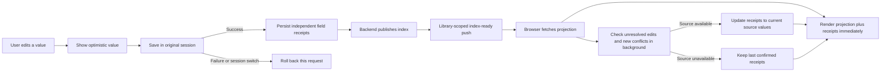
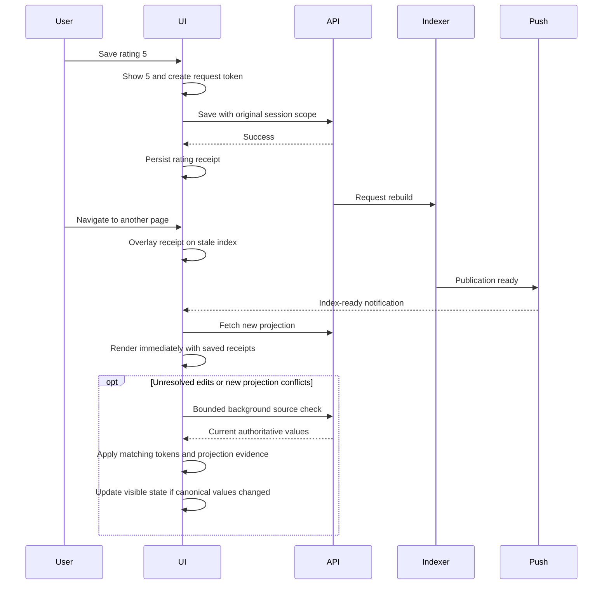

# Keeping UI edits visible while indexes catch up

The rendered value is the last downloaded index plus a journal of recent edits. The journal is separate from index caches: invalidating or downloading a snapshot must not erase a saved edit.

## Implemented behavior

- Ratings, likes, rotations, person labels, and album names overlay stale index and page results. Confirmed edits persist in browser storage, keyed by account and library, so remounting the app or reloading does not erase them. If browser storage is unavailable, the current session retains an in-memory journal.
- Confirmed fields use independent v2 storage records. Cross-tab events merge those records while retaining the entire local in-flight predecessor chain; unrelated saves cannot overwrite another tab's receipt. Legacy v1 confirmed values remain readable.
- Persistence serializes only the fields touched by the current confirmation, rollback, acknowledgement, or generation change. A bulk completion does linear work rather than flushing the complete journal once per entity.
- Each request has its own field tokens. Failure of an older request cannot roll back newer edits. Overlapping source writes to the same entity are serialized within this browser session; unrelated entities can save concurrently. Queued writes are cancelled if the account/library changes. HTTP dispatch and retries enforce the original session scope, including token acquisition that finishes after a switch.
- A job completion is an invalidation hint. A matching versioned snapshot can acknowledge the saved value, but a newer snapshot timestamp alone cannot replace it. Sort/People/Albums downloads use the version inside the payload rather than treating a dirty manifest as publication proof.
- `POST /api/tools/pending-edits/reconcile` verifies exact edited source rows in batches of at most 50, with at most eight concurrent reads per request. The authenticated library chooses the partition; request JSON cannot choose it. Only rating, likes, liked, rotation, and names are exposed. Source/storage failures do not acknowledge or delete receipts.
- A source read begun after save confirmation can update the receipt to a later authoritative value, even when indexing never published the intermediate value. Receipts remain overlaid on older index replicas after acknowledgement. Projection and cached reads return immediately with saved overlays. Source checks run in the background, update visible StoreProvider state when canonical values change, and never gate navigation. A response carrying older projection evidence cannot resolve a newer conflict; that conflict gets a follow-up check.
- Acknowledged receipts are passive: they are not submitted as edit history on every refresh. Only unresolved edits and concrete new projection conflicts demand a check. A pass handles at most 100 entities in two batches, has a three-second overall deadline, disables HTTP cold-start retries for these checks, and rotates unresolved work between passes. Timed-out and late responses preserve the current UI receipts.
- Versioned observations use one persisted publication high-water mark for acknowledgement, conflict creation, and conflict clearing. Older matching and conflicting rows cannot cancel newer reconciliation, including after reload. Source responses are fenced by both the conflict evidence and publication revision captured when the check began. Pending conflicts keep the recovery poller active.
- Each fresh request captures a distinct read identity before dispatch. Visible conflicting unversioned rows can therefore demand another bounded source check even when the value equals a previously stale value. Older outstanding page responses cannot replace evidence from a later request. Cached snapshots and render-only lookups do not create fresh-read identities or repeatedly recheck the same acknowledged value.
- The actual payload version is persisted separately from the manifest cache validator, so cached rows retain the evidence needed to distinguish a newer conflict from an older replica.
- Source verification also handles server-paged libraries (including libraries above the 200,000-photo client index limit), source fallbacks, and cached-IDB reads. Successful verification stops treating those edits as pending without requiring a full index download. It confirms source persistence, not completion of the rebuild; the receipt continues protecting the UI while that work runs.
- Replacing an uploaded photo with a provably newer physical thumbnail generation releases patches for the previous upload. The generation revision is persisted with the receipt, restored for IndexedDB snapshots, and inherited by subsequent edits. Older, equal-revision conflicting, or unversioned observations cannot erase an ordered receipt. Legacy receipts without a revision establish an ordered baseline conservatively before accepting a later replacement.
- The People page fetches exact pending person IDs when a stale first page has not yet moved a newly named person into that page. Those extra rows do not advance the server pagination offset; enrichment is capped at 100 unresolved person IDs per first-page read in batches of 50. Pending names are filtered against the query before applying the budget; broad reads rotate candidates fairly. Results are deduplicated, renamed-away search rows are filtered out, and search results retain the requested limit. Enrichment rows retain their own payload revision.
- Album detail merges and albumById apply saved name receipts, including responses that began before a rename. Cached gallery, album, person, and viewer photo lookups apply the same photo edits. Existing photo-removal guards remain in place.

This is a browser consistency buffer for the listed fields. It does not replace authoritative source persistence, repair the backend publication races described in the audits, or implement a general offline write queue. Album membership, arbitrary metadata fields, and other mutation types are not automatically enrolled merely because they can schedule index work.

## People rebuild coverage

A dirty People manifest cannot prove that a supplied person-ID list includes every change. Both ID-only and timestamp incremental paths therefore require a verified clean base; otherwise the builder scans the current source fully. This costs more for a dirty library but prevents a label refresh from erasing unrelated trash/restore visibility changes. Targeted point-read updates remain available for a clean matching base.

## Immediate publication notifications

`backend/index_events.py` sends advisory `index-ready` messages through Azure Web PubSub. Both dedicated index-maintenance completion and legacy cluster index completion call the notification hook. Dedicated notifications occur after the work lease/publication guard and durable intent completion succeed. Deferred Search repair and still-queued work do not announce readiness.

The authenticated `POST /api/tools/index-events/negotiate` endpoint chooses the subscription group from the authenticated active library. A client cannot choose another library via request JSON. Tokens prejoin that group and grant no client send or arbitrary group-join permissions. The token response is not cacheable.

The browser keeps the WebSocket connection, refreshes data on a ready event, reconnects with backoff, and reconciles missed publications when reconnecting. It renews the connection through fresh authentication and discards old-library callbacks after a switch. Large index payloads still use the ordinary download paths; they are not broadcast inside WebSocket messages.

The existing job poller remains the recovery path for notification loss or deployments without push. It continues while jobs are active or edits have not been confirmed by an actual matching projection or authoritative source check, within its existing 20-minute polling bound. It retries refresh while unresolved edits remain. Focus/mutation nudges can restart it. Push failure never fails an otherwise successful index publication.

## Deployment

The Bicep and generated ARM template add optional `enableIndexPush`, default **false**. Setting it to true provisions one Standard Web PubSub unit and assigns the resource-scoped Web PubSub Service Owner data role to indexer and cluster identities. The indexer API and its worker share the indexer identity. Backend containers receive `INDEX_EVENTS_ENDPOINT`; no service access key is exposed to the browser. The frontend runtime CSP retains the managed WebSocket origin with and without a configured API URL.

Deploy the backend reconciliation endpoint before the updated frontend; source verification retains saved receipts if the endpoint is temporarily unavailable during rollout. To activate true push, deploy the updated backend and frontend images and infrastructure with `enableIndexPush=true`. Updating only the images leaves polling as the refresh mechanism. No live Azure resources were deployed for this change. Local Bicep compilation succeeded with the repository's existing Storage/Log Analytics warnings; it is not live Azure validation.

SDK dependency: `azure-messaging-webpubsubservice>=1.3.0,<2`. For an already provisioned service, configure `INDEX_EVENTS_ENDPOINT` and grant the two server identities the corresponding data-plane role.

Primary references: [Azure Web PubSub Python SDK](https://learn.microsoft.com/en-us/python/api/overview/azure/messaging-webpubsubservice-readme?view=azure-python), [client token API and group permissions](https://learn.microsoft.com/en-us/python/api/azure-messaging-webpubsubservice/azure.messaging.webpubsubservice.webpubsubserviceclient?view=azure-python), [managed identity authorization](https://learn.microsoft.com/en-us/azure/azure-web-pubsub/howto-use-azure-identity).

## Release validation

The audit findings and their original reproductions are in `docs/audits/ui-index-consistency-2026-10-22.md`. Release regression tests cover session changes before queued dispatch and during HTTP retries, concurrent tab persistence and rollback, migration, skipped intermediate values, source failures, old responses, bounded batches, paged libraries, and refresh ordering. Runtime CSP is tested with a production-style API URL as well as the empty fallback.

**127 focused frontend tests and 148 backend tests passed.** TypeScript checking, the production frontend build, shell syntax, and diff checks passed.

No live Azure resources were deployed, and the managed WebSocket transport has not been tested against a live service. See the latest remediation note in `docs/audits/all-uncommitted-2026-10-22.md` for the final local check results.
